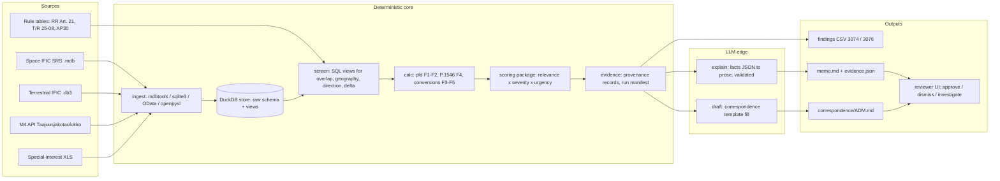

# Solution 01: Deterministic Screening Pipeline (calculation-first, LLM at the edges)

> [!NOTE]
> Thesis: treat an IFIC as a database, not as a document. Load the Space IFIC (SRS database) and the Terrestrial IFIC (SQLite) into one local analytical store, express every screening rule, cross-comparison and calculation as unit-tested code and SQL views, and let the language model do only what code cannot: turn the computed facts into readable explanations and correspondence drafts. The single bet is that a judge values a run that anybody can repeat with one command, with every number traceable to a table row and a formula, more than an impressive but opaque assistant.

Source tags: `[BRIEF]` official brief, `[README]` repo README, `[FACTS]` from `solutions/00_shared_facts.md` (URL repeated), `[HYPOTHESIS]` reasoned but unverified, `[GAP - ASK PARTNER]` must be asked at the Q&A stand.

## 1. Summary

**What it is.** A command-line pipeline (`ific run space 3074`, `ific run terra 3076`) that ingests one IFIC issue, cross-compares it with the Finnish table of frequencies (Regulation M4 via the Traficom open-data API), the special-interest station list (XLS) and the applicable protection criteria, computes power flux-density (space) or field strength (terrestrial) deterministically, scores and ranks the candidate items, and writes a findings file, an evidence bundle and draft correspondence per counterparty administration. A thin reviewer UI reads the output files; the expert approves, dismisses or sends a finding back for investigation. `[BRIEF]` asks for exactly this chain: ingest national information, retrieve IFICs, identify systems, calculate pfd, cross-compare with M4/M15, explain concerns, identify the counterparty and draft correspondence.

**Who uses it.** A Traficom spectrum specialist on the day a new IFIC appears. The pipeline is the first pass; the specialist owns every decision `[README]`.

**What it outputs.** `results/space_ific_3074_findings.csv` and `results/terrestrial_ific_3076_findings.csv` (the mandatory separate accuracy files `[BRIEF]`), one Markdown memo per IFIC, one correspondence draft per administration with at least one priority-A finding, an evidence bundle (JSON) and a run manifest (inputs hashed, software version, weights version).

**Why it scores well.** Criteria A (technical analysis and reproducibility, 25 %) and E (auditability, 15 %) are satisfied by construction: deterministic code, visible parameters, provenance per row. Criterion B (extensibility, 25 %) is answered by running the same stages on the terrestrial database with a different calculator (P.1546 instead of pfd) and a different criterion (T/R 25-08 instead of RR Article 21). Criterion D (accuracy, 15 %) depends on the quality of the rules, which is where the Saturday Q&A time goes. Criterion C (usefulness and innovation, 20 %) is the weak spot of this angle and is addressed with ranking quality and output clarity, not with more AI.

**Reuse.** The `scoring/` package already built on branch `claude/folder-scoring-system-a430c2` (`score = 100 x relevance x (0.65 severity + 0.35 urgency)`, `relevance = freq_overlap x geography x direction`, weights in `scoring/weights.json`, reasoning in `scoring/DESIGN.md`, 52 passing tests) is the ranking stage of this pipeline. It is imported as is; the pipeline supplies the factor inputs and the P.1546 field-strength factor that the package still lacks.

## 2. Requirements map

| Brief workflow step | Component or mechanism | Status | Notes |
|---|---|---|---|
| Ingest national info: M4 via API | `ingest/m4.py` pulls `https://opendata.traficom.fi/api/v13/Taajuusjakotaulukko` (OData, `$top`/`$skip` paging, 5917 rows; capitalised services in `Services_in_Finland` = primary) `[FACTS]` | core | Snapshot committed under `data/reference/` so runs are reproducible offline. |
| Ingest special-interest XLS | `ingest/special_interest.py` with openpyxl, schema validated by Pydantic | core | Column names unknown until the file is seen `[GAP - ASK PARTNER]`; adapter isolates them. |
| Ingest M15 | Parsed as a band list only | stretch | `[BRIEF]` says less relevant; used only to annotate licence-exempt bands. |
| Detect and retrieve new IFICs | `ific watch` polls the BR IFIC index pages and the local drop folder; `ific fetch N` | core (poll), stretch (download) | Whether the download needs an ITU TIES account is unknown `[GAP - ASK PARTNER]`. |
| Ingest Space IFIC (API/A, CR/C, AP30/30A/30B) | `ingest/srs.py` exports the SRS `.mdb` tables with mdbtools into DuckDB; special-section type and date from `pub_ssn` `[FACTS]` | core | AP30/30A/30B rows are flagged by special-section type; plan-specific examination is stretch. |
| Identify interesting satellite systems | SQL views `v_candidate_groups`: frequency overlap x geography x direction gates | core | Section 5. |
| pfd calculation (GSO and NGSO) | `calc/pfd.py`, formula F1 with slant range F2 | core | NGSO as worst-case single-satellite pfd, labelled indicative; epfd per RR Article 22 out of scope. |
| Summarise relevant content and frequency ranges | SQL aggregation per notice plus LLM prose from the facts JSON | core | |
| Cross-compare with M4/M15 and special-interest table | Interval join between group frequency ranges and the Finnish table rows; point-in-band join for stations | core | |
| Identify items concerning Finland | `scoring.rank_groups` with priority A/B/C | core | Reused package. |
| Explain concerns with calculations | Evidence bundle per finding: rows, formula id, inputs, result, limit, margin | core | Section 8. |
| Identify counterparty administration | `notice.adm` of the filing; for AP30 plan items the notifying administration `[HYPOTHESIS]` | core | |
| Draft correspondence template | LLM fills a fixed template from the evidence bundle; expert edits | core | Section 10. |
| Space IFIC 3074 result file | `results/space_ific_3074_findings.csv` plus memo | core | Mandatory `[BRIEF]`. |
| Terrestrial: diff consecutive IFICs | `ingest/terra.py` loads `BRIFIC_3075.db3` and `BRIFIC_3076.db3`; `v_terra_delta` classifies new, modified, withdrawn | core | Section 9. |
| Filter foreign land-mobile assignments relevant to Finland | Distance to the Finnish border, band overlap with M4 land-mobile rows, neighbouring administrations first | core | |
| Determine ITU/CEPT/national framework | Rule table `rules/framework.yaml` keyed by band: RR Article 5, CEPT recommendation, M4 row | core | |
| Identify criterion (ECC T/R 25-08) | Trigger table from Annex 1 `[FACTS]` | core | |
| P.1546 field strength | `calc/p1546.py` wrapping the ITU-R reference implementation | core | Section 6. |
| Expert-reviewable findings with parameters and citations | Same evidence bundle schema as space | core | |
| Terrestrial IFIC 3076 result file | `results/terrestrial_ific_3076_findings.csv` plus memo | core | Mandatory `[BRIEF]`. |
| Trends and anomalies in neighbouring administrations' notices | SQL over consecutive issues: counts by administration, band, station class, bandwidth; z-score against the previous issues | core (counts), stretch (anomaly scoring) | Needs at least three consecutive issues to be meaningful. |

## 3. Architecture

Everything left of the LLM box is deterministic Python and SQL. The LLM box receives JSON only and returns text that is validated before it is stored.



**Split of responsibilities.**

| Deterministic code (must be reproducible) | LLM (must be grounded) |
|---|---|
| Parsing, unit conversion, frequency interval joins, geometry, pfd, P.1546, delta between issues, scoring, ranking, limits lookup, counterparty lookup, file outputs | Explanation paragraph per finding, memo narrative, correspondence draft, optional extraction of fields from PDF special sections when the database lacks them |

The pipeline is a sequence of stages with a stable contract (`Filing`, `Group`, `Finding`, `Evidence`, `RunManifest` Pydantic models). Each stage reads from and writes to DuckDB tables, so a failed stage can be re-run alone and the whole run is replayable from the manifest.

## 4. Data ingestion

**Space IFIC.** The Space IFIC ships an SRS-format Microsoft Access database. The tables of interest are `notice`, `grp`, `freq`, `s_beam`, `emiss`, `geo`, `orbit`, `non_geo`, `srv_area`, `srv_cls`, `provn` and `pub_ssn` `[FACTS]`, documented in https://www.itu.int/en/ITU-R/software/Documents/spaceqry/srs_dbv6.pdf. On macOS and Linux the `.mdb` is read with mdbtools (`brew install mdbtools`; `mdb-tables`, `mdb-export` to CSV) `[HYPOTHESIS]` https://github.com/mdbtools/mdbtools, then loaded into DuckDB with `read_csv_auto`. Fallback if mdbtools fails on this file: the pure-Python `access-parser` package `[HYPOTHESIS]`, and as a last resort export from Access or SpaceQry on one Windows laptop and commit the CSVs.

Columns actually used, with the mapping kept in one file (`ingest/srs_columns.yaml`) so a wrong guess costs one edit. The names below are our expectation from the SRS structure document and must be confirmed against the real file on Friday night `[HYPOTHESIS]`:

| Need | Expected table.column | Used for |
|---|---|---|
| Notice identity, administration, satellite name, nominal longitude | `notice.ntc_id`, `notice.adm`, `notice.sat_name`, `notice.long_nom` | Counterparty, GSO geometry |
| Notice reason (advance publication, coordination, notification) | `notice.ntf_rsn` | Stage and deadline |
| Special-section identifier and publication date | `pub_ssn.ssn_ref`, `pub_ssn.d_pub` (or equivalent) | API/A vs CR/C vs AP30 classification; 4-month window |
| Frequency group ranges and direction | `grp.grp_id`, `grp.freq_min`, `grp.freq_max`, `grp.emi_rcp` (E = emission, R = reception) | Overlap and direction gates |
| Assigned frequencies | `freq.freq_mhz` (or `freq_assgn`) | Finer overlap |
| Emission bandwidth and power | `emiss.design_emi`, `emiss.pwr_tot_pk`, `emiss.pwr_ds_max` (dBW/Hz) | pfd |
| Beam gain | `s_beam.gain` | pfd |
| Orbit parameters for NGSO | `non_geo`/`orbit`: altitude, inclination, number of planes | NGSO geometry |
| Service area | `srv_area` geographical-area codes | Geography gate |

**Terrestrial IFIC.** Since IFIC 3042 (18 March 2025) the Terrestrial IFIC is a SQLite file `BRIFIC_nnnn.db3` (TerRaBase) with FXM domain tables `fxm_terra`, `fxm_ant`, `fxm_tx`, `fxm_rx`, `fxm_geo` `[FACTS]`, documented at https://www.itu.int/ITU-R/terrasys/docs/db/structure. Land-mobile notices use the T12 item keys such as `t_freq_assgn`, `t_lat` (+DDMMSS), `t_pwr_dbw` with `t_pwr_eiv`, `t_hgt_agl` and `t_azm_max_e` `[FACTS]`. SQLite is read with the Python standard library; DuckDB attaches it directly. The fields for station class, emission designator, administration, action code and notice status are expected under the same `t_` naming `[HYPOTHESIS]` and confirmed on the first file.

**M4 and the Finnish table.** `GET https://opendata.traficom.fi/api/v13/Taajuusjakotaulukko` with OData paging returns 5917 rows `[FACTS]`; a snapshot from 6 November 2026 already exists at `scoring/reference/taajuusjakotaulukko_2026-11-06.json.gz`. Each row is parsed into `(lower_mhz, upper_mhz, services, primary_flag, usage_text, footnotes)`; the exact field names beyond `Services_in_Finland` are taken from the snapshot `[HYPOTHESIS]`. The regulation text on Finlex is kept only as a citation target (`https://www.finlex.fi/fi/viranomaiset/maarayskokoelmat/traficom-viestinta/2026/3`).

**Special-interest stations.** openpyxl reads the XLS; the adapter maps columns to `(station_id, centre_mhz, bandwidth_khz, lat, lon, antenna_height_m, azimuth_deg, directivity, criterion)` and reports any column it could not map rather than guessing `[GAP - ASK PARTNER]`.

**Rules and limits.** `rules/rr_article21_table21-4.json` (pfd limits by band and angle of arrival), `rules/tr_25_08.json` (Annex 1 triggers) and `rules/framework.yaml` (band to regulatory framework). Each entry carries `source`, `verified` and `verified_by`. The existing `scoring/reference/rr_article21_table21-4.json` still has rows marked `verified: false`; the Saturday space slot is used to close them.

**Fallbacks.** If the SRS file cannot be read by Saturday 09:00, the pipeline runs on the CSV export made on a Windows machine; if no real IFIC is available at all, the synthetic generator from the PM pack produces SRS-shaped tables so every downstream stage still runs and is demonstrable.

## 5. Relevance detection for Finland (space)

Relevance is a product of three gates, each 0 to 1, computed in SQL views and then handed to `scoring.rank_groups`.

**Gate 1, frequency overlap.** A frequency group `(freq_min, freq_max)` is joined against the Finnish table rows it intersects. Overlap fraction `= overlap_width / group_width`. Rows where Finland has a primary terrestrial or Earth-station service (capitalised entries in `Services_in_Finland` `[FACTS]`) count fully; secondary services count at 0.5 `[HYPOTHESIS]`, adjustable in `weights.json`. A second join hits the special-interest stations whose centre frequency plus or minus half bandwidth falls inside the group; any hit sets a flag that bypasses the overlap fraction.

**Gate 2, direction.** For a Finnish terrestrial receiver the threat is a space-to-Earth emission, so groups with `emi_rcp = 'E'` on a space station are the pfd candidates. Earth-to-space groups matter only where Finland operates or has filed satellite receivers in the band; the list of Finnish satellite networks in the ITU records is unknown to us and is a Q&A question `[GAP - ASK PARTNER]`. Until then uplinks get direction weight 0.3 `[HYPOTHESIS]`.

**Gate 3, geography.** For GSO networks the pipeline computes the elevation angle from six reference points (Mariehamn 60.1N 19.9E, Helsinki 60.2N 24.9E, Turku 60.5N 22.3E, Oulu 65.0N 25.5E, Rovaniemi 66.5N 25.7E, Utsjoki 69.9N 27.0E) to the nominal longitude `long_nom` with formula F2. The group is visible if the maximum elevation over the points is at least 0 degrees; the geography weight rises linearly from 0 at 0 degrees to 1 at 10 degrees `[HYPOTHESIS]`, because Article 21 limits are least restrictive at low angles and the useful signal in Finland is also lowest there. For NGSO networks the group is geographically relevant if the inclination is at least the latitude of the southernmost reference point minus the coverage half-angle; in practice any inclination of 55 degrees or more reaches all of Finland `[HYPOTHESIS]`. Service-area codes in `srv_area` are used as a confirmation signal when they contain a code covering Finland (the ITU geographical-area codes covering Finland are an open item in `scoring/DESIGN.md`).

**Stage and urgency.** `ntf_rsn` and the special-section type give the stage: API/A advance publication, CR/C coordination request, AP30/30A/30B plan modification. The urgency factor is the remaining fraction of the 4-month comment window from the special-section publication date (RR 9.3, 9.52 and AP30 4.1.5 `[FACTS]`). Space IFIC 3074 was published 23 June 2026 `[FACTS]`, so its windows closed around 23 October 2026 and urgency is 0 for the evaluation run; the findings file says so explicitly rather than hiding it.

**Severity.** For pfd candidates, severity is the margin between the computed pfd (section 6) and the applicable limit, mapped to 0 to 1 over a range of minus 20 dB to plus 10 dB `[HYPOTHESIS]`; for groups without usable power data the severity is set from overlap width and primary-service status only and the finding is tagged `power_unknown`.

**Ranking.** `score = 100 x relevance x (0.65 severity + 0.35 urgency)` with priority A at 70 or above, B at 45, C at 20, taken from the scoring package. Everything below C is kept in the full table with its reasons so the evaluator can see what was deliberately not raised.

## 6. Technical calculations

Every formula has an identifier, a docstring with units, and a test vector in `tests/test_calc.py`. Results are stored with the formula id, the inputs and the software version, and are labelled `indicative` in every output.

**F1, pfd at the Earth's surface.** With e.i.r.p. spectral density `D` in dBW/Hz, slant range `d` in metres and reference bandwidth `B_ref` in Hz:

`pfd_ref (dBW/m2 per B_ref) = D + 10 log10(B_ref) - 10 log10(4 pi d^2)`

When the filing gives total peak power `P` (dBW) in an emission of necessary bandwidth `B` (Hz) and a beam gain `G` (dBi) instead of a density, the density is approximated as `D = P + G - 10 log10(B)`, which assumes a flat spectrum across the emission; this assumption is written into the evidence. Free-space propagation and no atmospheric loss are assumed, which makes the value conservative (an over-estimate). At `d = 38,000 km` the spreading term `10 log10(4 pi d^2)` is 162.6 dB; a density of minus 40 dBW/Hz therefore gives about minus 166.6 dBW/m2 per Hz, or minus 130.6 dBW/m2 per 4 kHz. The reference bandwidth is taken from the applicable limit row (4 kHz or 1 MHz depending on the band).

**F2, GSO geometry.** For a ground point at latitude `lat`, longitude `lon` and a satellite at longitude `lon_s`, with `R_e = 6378.137 km` and `R_s = 42164.17 km`:

`cos(g) = cos(lat) x cos(lon_s - lon)` (central angle g)

`d = sqrt(R_e^2 + R_s^2 - 2 R_e R_s cos(g))` (slant range)

`elevation = atan2(cos(g) - R_e / R_s, sin(g))`

Sanity values: at 60 N directly south of the satellite the elevation is about 22 degrees; at 70 N about 11.5 degrees; the satellite is below the horizon when `cos(g) < R_e / R_s`, that is beyond roughly 75 degrees of longitude difference at 60 N. These are the test vectors.

**NGSO worst case.** For a shell at altitude `h` with inclination `i`, the minimum slant range to a point at latitude `lat` is `h` when `i >= lat` (satellite can pass overhead) and otherwise the range to the shell at latitude `i`, computed with F2 using `R_e + h` instead of `R_s` and the latitude difference instead of the longitude difference. The pfd from F1 at that range is the single-satellite worst case; aggregate epfd per RR Article 22 is out of scope and stated as such.

**Limits.** The computed pfd is compared with the RR Article 21 Table 21-4 limit for the band and the angle of arrival (three bands of angle: 0 to 5, 5 to 25, 25 to 90 degrees) `[HYPOTHESIS]`, taken from `rules/rr_article21_table21-4.json` with its `verified` flags. For AP30/30A/30B items the plan limits apply instead and are a Q&A question `[GAP - ASK PARTNER]`. Special-interest stations with their own criterion in the XLS use that value. `margin_db = pfd_calc - limit`; a positive margin is an exceedance.

**F3, power conversions.** `e.r.p. (dBW) = e.i.r.p. (dBW) - 2.15`; `dBW = dBm - 30`; `dBkW = dBW - 30`. The terrestrial `t_pwr_dbw` with `t_pwr_eiv` (which quantity the value is) `[FACTS]` is normalised to e.r.p. in dBkW because P.1546 curves are given for 1 kW e.r.p.

**F4, ITU-R P.1546 field strength.** Inputs: frequency (30 to 4000 MHz), distance (1 to 1000 km), effective transmitting antenna height (from `t_hgt_agl` plus terrain, or the height above ground when no terrain data is available, stated as an assumption), time percentage 10 % (the T/R 25-08 reference), location percentage 50 %, path type land, cold sea or mixed (Gulf of Bothnia and Gulf of Finland paths are mixed), receiving antenna height 10 m `[HYPOTHESIS]`. Output: field strength in dB(uV/m) for 1 kW e.r.p., then `E = E_1kW + erp_dBkW`. The implementation is the ITU-R Study Group 3 reference Python port `Py1546` `[HYPOTHESIS]` https://github.com/eeveetza/Py1546, vendored with its validation examples as our tests; if it cannot be installed in time, a table interpolation of the P.1546 land curves at 100 MHz, 600 MHz and 2000 MHz is implemented from the Recommendation text and labelled as such.

**F5, bandwidth normalisation for T/R 25-08.** The trigger is defined per 25 kHz; for a channel bandwidth `B_ch` the trigger is raised by `10 log10(B_ch / 25 kHz)` `[FACTS]`.

**Reproducibility.** Python and dependency versions pinned in `uv.lock`; `rules/*.json` and `scoring/weights.json` carry a version; the run manifest records the git SHA, the SHA-256 of every input file, the weights version and the rule-file versions; `ific run` with the same manifest reproduces byte-identical CSVs (the LLM text is cached by input hash and excluded from the determinism check).

## 7. AI components and guardrails

The model is used in three places and nowhere else.

1. **Explanation per finding.** Input: the finding's facts JSON (rows, formula ids, inputs, results, limits, margins, regulation references). Output: a four-to-six-sentence explanation that may reference only evidence ids present in the input. A validator rejects any sentence containing a number that does not appear in the input JSON (string match after normalising units), and any evidence id not in the input.
2. **Memo narrative.** Input: the ranked table and the per-finding explanations. Output: a one-page summary ordered by priority. Same validator.
3. **Correspondence draft.** Input: the counterparty administration, the findings against its filings, and the fixed template in `templates/correspondence.md`. Output: the filled template. The draft is always marked `DRAFT - not sent` and is never transmitted anywhere by the tool `[README]`.

Optional fourth use, behind a flag: extraction of frequency ranges and power from PDF special sections for items where the database lacks a value; the extracted value is tagged `source: pdf-extract` and shown as such.

Guardrails: temperature 0; structured output schema; model `claude-sonnet-5-5` through the Claude API, with the client behind an `LLMClient` interface so a local open-weight model can replace it if the partner's data terms require `[GAP - ASK PARTNER]`; responses cached by input hash; when the model output fails validation the finding is published with the facts table and the text "explanation unavailable" rather than with an unvalidated paragraph. Unknown values stay `unknown` in the facts and therefore in the prose.

## 8. Auditability and evidence model

Each finding references evidence records; each evidence record points at exactly one source location or one computation.

```json
{
  "finding_id": "S3074-000123",
  "ific": {"kind": "space", "number": 3074, "file_sha256": "..."},
  "subject": {"ntc_id": 123456789, "adm": "AUS", "sat_name": "...", "grp_id": 7},
  "priority": "A", "score": 78.4,
  "factors": {"freq_overlap": 1.0, "geography": 0.9, "direction": 1.0, "severity": 0.8, "urgency": 0.0},
  "evidence": [
    {"id": "E1", "kind": "row", "source": "BRIFIC3074 SRS grp", "key": {"ntc_id": 123456789, "grp_id": 7}, "fields": {"freq_min": 3700.0, "freq_max": 4200.0, "emi_rcp": "E"}},
    {"id": "E2", "kind": "row", "source": "Taajuusjakotaulukko 2026-11-06", "key": {"row": 2311}, "fields": {"lower_mhz": 3600, "upper_mhz": 3800, "services": "MOBILE (primary)"}},
    {"id": "E3", "kind": "calc", "formula": "F2", "inputs": {"lat": 60.2, "lon": 24.9, "lon_s": 150.0}, "result": {"elevation_deg": 3.1, "slant_km": 40950}},
    {"id": "E4", "kind": "calc", "formula": "F1", "inputs": {"D_dBW_Hz": -42.0, "d_m": 40950000, "B_ref_Hz": 4000}, "result": {"pfd": -131.3}},
    {"id": "E5", "kind": "rule", "source": "RR Article 21 Table 21-4", "key": {"band": "3400-4200 MHz", "angle": "0-5"}, "fields": {"limit": -152.0, "verified": false}}
  ],
  "run": {"git_sha": "...", "weights_version": "1.0.0", "rules_version": "2026-11-07"}
}
```

Citation format in prose and CSV: `BRIFIC3074/SRS/grp[ntc_id=123456789,grp_id=7]`, `M4/Taajuusjakotaulukko[row=2311]`, `RR/Art21/Table21-4[3400-4200 MHz, 0-5 deg]`, `TR25-08/Annex1[108-380 MHz]`, `BRIFIC3076/fxm_terra[t_adm=S, t_freq_assgn=160.2125]`. An expert verifies a conclusion by opening the row in SpaceQry or the SQLite file, re-running the formula with the printed inputs, and checking the limit row in the Radio Regulations. The reviewer UI shows the evidence list under every finding; nothing renders without at least one evidence record (a test enforces it, as in the PM pack).

## 9. Terrestrial side quest

The same five stages run with three substitutions: the ingest reads SQLite instead of Access, the calculator is P.1546 instead of pfd, and the criterion is T/R 25-08 instead of Article 21. Everything else (store, evidence schema, scoring package, memo, correspondence, UI) is shared, which is the point of criterion B.

1. **Consecutive issues.** `BRIFIC_3075.db3` and `BRIFIC_3076.db3` are attached; `v_terra_delta` matches notices by administration, assignment key and location (`t_adm`, `t_freq_assgn`, `t_lat`, `t_long`, station name `[HYPOTHESIS]`) and classifies rows as new (in 3076 only), withdrawn (in 3075 only) and modified (same key, different technical fields; the changed fields are listed). If the database carries an explicit action or fragment code, it is used first and the key-based diff becomes the cross-check `[GAP - ASK PARTNER]`.
2. **Filter foreign assignments relevant to Finland.** Keep land-mobile notices from administrations other than FIN whose site lies within 300 km of the Finnish border polygon (Natural Earth or GADM boundary, shapely distance in a metric projection) `[HYPOTHESIS]` and whose frequency falls in a band where M4 shows Finnish land-mobile or other primary use. Neighbouring administrations (S, NOR, EST, RUS by ITU symbol `[HYPOTHESIS]`) are examined first; others are included only on a frequency hit.
3. **Regulatory framework.** `rules/framework.yaml` maps the band to RR Article 5 allocation, the CEPT instrument (T/R 25-08 for 29.7 to 470 MHz land mobile `[FACTS]`; other bands tagged `[GAP - ASK PARTNER]`) and the M4 row; the finding cites all three.
4. **Criterion.** T/R 25-08 (edition June 2025, https://docdb.cept.org/download/4789) Annex 1 triggers: 0, 6, 12, 18 and 20 dB(uV/m) per 25 kHz at 10 m height for 10 % of time in the bands 29.7 to 47, 47 to 108, 108 to 380, 380 to 400 and 400 to 470 MHz, plus `10 log10(channel bandwidth / 25 kHz)` `[FACTS]`.
5. **Field strength.** F4 is evaluated from the station (`t_lat`, `t_long`, `t_hgt_agl`, e.r.p. from `t_pwr_dbw` and `t_pwr_eiv`, azimuth `t_azm_max_e` with the antenna pattern reduced to a front-to-back assumption when no pattern is available) to the nearest point of the Finnish border and to the three nearest border points at 50 km spacing; the maximum is compared with the trigger. The antenna gain towards Finland is reduced by a stated amount only when the azimuth points away by more than 90 degrees `[HYPOTHESIS]`.
6. **Findings.** Same evidence schema: source notice rows, formula F4 inputs (frequency, distance, heights, time and location percentages, path type), the result, the trigger with its bandwidth correction, the margin, and the M4 and T/R 25-08 citations.
7. **Trends and anomalies.** Over all available consecutive issues, SQL counts of new notices by administration, band (M4 row), station class and bandwidth; for each cell a z-score against the previous issues; cells above 2 are listed as anomalies with the underlying rows. Examples the memo would surface: a jump in 400 to 470 MHz notices from one administration near the border, a new bandwidth class, or first activity in a band `[BRIEF]`.

## 10. Outputs and deliverables

**Findings CSV, space (`results/space_ific_3074_findings.csv`).** Columns: `finding_id, ific_no, special_section, ntc_id, adm, sat_name, orbit_type, long_nom, grp_id, freq_min_mhz, freq_max_mhz, direction, m4_rows, finnish_services, special_interest_station_ids, elevation_min_deg, elevation_max_deg, slant_range_km, pfd_dbw_m2, pfd_ref_bw_hz, pfd_limit, limit_source, margin_db, power_source, freq_overlap, geography, direction_factor, severity, urgency, score, priority, concern_type, comment_deadline, evidence_ids, explanation, reviewer_decision, reviewer_note`.

**Findings CSV, terrestrial (`results/terrestrial_ific_3076_findings.csv`).** Columns: `finding_id, ific_no, change_type, changed_fields, adm, notice_key, freq_mhz, bandwidth_khz, station_class, site_name, lat, lon, distance_to_border_km, erp_dbkw, antenna_height_m, azimuth_deg, framework_rr, framework_cept, m4_row, trigger_dbuv_m, trigger_bw_correction_db, p1546_field_strength_dbuv_m, p1546_inputs, margin_db, score, priority, evidence_ids, explanation, reviewer_decision`.

Both files are accompanied by `results/<ific>_memo.md`, `results/<ific>_evidence.json`, `results/<ific>_manifest.json` and `results/<ific>_not_raised.csv` (every examined item with the gate that excluded it, so false negatives can be audited).

**Correspondence draft (`results/correspondence/<ADM>_<ific>.md`).** Template: addressee (administration and, where known from the notice, the contact `[GAP - ASK PARTNER]`); reference to the special section and notice ids; the Finnish assignments or allocations concerned with M4 citation; the technical concern with the computed pfd or field strength, the limit and the margin, all with formula ids and inputs; the request (inclusion in coordination under RR 9.41/9.52 for CR/C, a technical response for API/A, a border-coordination request under T/R 25-08 for terrestrial) `[HYPOTHESIS]`; a closing line reserving rights. Header: `DRAFT for expert review - generated <run_id>`.

**Input/output documentation.** `docs/io.md` lists every input file, the columns consumed, every output file and its columns, and the formulas with their test vectors. The repo root `README.md` gets a five-minute setup and the two commands that regenerate the 3074 and 3076 files.

**Repo layout.** `ific/` (cli, ingest, screen, calc, evidence, llm), `scoring/` (reused), `rules/`, `data/reference/` (M4 snapshot, border polygon), `data/ific/` (git-ignored IFIC files), `results/` (committed for 3074 and 3076), `ui/`, `tests/`, `docs/`.

## 11. Human-in-the-loop UI

One screen, read from the output files. Left: the ranked findings list with priority badge, administration, band, margin and deadline. Centre: the selected finding's facts table and evidence list, a small frequency strip showing the group range against the M4 rows it overlaps, and for GSO items the elevation per reference point. Right: the explanation, the correspondence draft, and three buttons: approve, dismiss, investigate, each requiring a one-line note. Decisions append to `results/<ific>_decisions.jsonl` with reviewer, decision, note and time; the findings CSV is regenerated with the decision columns filled. No login, no settings, no automatic sending. The design tokens come from `design/girlypop.css`; findings and decisions use plain copy per the theme's serious-context rule.

## 12. Tech stack

Python 3.12 with `uv`; DuckDB (spatial extension for the border distance) as the single store; mdbtools and `access-parser` for the SRS file; `sqlite3` for TerRaBase; `httpx` for the OData API; `openpyxl` for the XLS; `shapely` and `pyproj` for geometry; `Py1546` vendored for propagation; `pydantic` v2 for contracts; `typer` for the CLI; `pytest` with the formula test vectors; Claude API `claude-sonnet-5-5` behind `LLMClient`. UI: FastAPI serving a small React and Vite front end with the existing design system; fallback is a Streamlit page over the same CSV, acceptable for the demo. Why: every component is boring, installable in minutes on macOS, and leaves the demo independent of network access except for the cached LLM text.

## 13. Build plan: Fri 19:30 to Sun 10:00

| Sprint | Time | Owner | Deliverable | Gate |
|---|---|---|---|---|
| S1 | Fri 19:30 to 23:30 | BE: SRS export with mdbtools into DuckDB, column map confirmed; AI: M4 ingest from the snapshot, XLS adapter; FE: UI skeleton over a fake findings CSV; PM: briefing notes into `00_shared_facts.md` | Gate 1 at 22:30: real SRS tables queryable, or the synthetic SRS-shaped tables in place | Fail: switch to CSV export on a Windows laptop or synthetic data. |
| S2 | Fri 23:30 to Sat 03:30 | BE: overlap, direction and geography views; AI: F1, F2 with test vectors, scoring package wired; FE: findings list reads real rows | Ugly end-to-end on 3074: a ranked CSV exists | |
| Sleep | Sat 03:30 to 07:30 | Two sleep, two keep the pipeline green | | |
| S3 | Sat 07:30 to 11:30 | PM at the Q&A stand from 09:00; space specialists Sat 10 to 11: confirm Table 21-4 rows, area codes covering Finland, where the affected-administration list sits, meaning of CR/D, CR/E, CR/F, Finnish networks in the records, download access; BE: terrestrial SQLite ingest and delta view; AI: evidence bundle and manifest | Gate 2 at 09:00: live demo of the 3074 run to the partner | Lukewarm: tighten the relevance rules with the specialists before building more. |
| S4 | Sat 11:30 to 15:30 | PM at terrestrial slot Sat 11 to 12: confirm T12 keys, action codes, coordination practice with S, NOR, EST, RUS, antenna assumptions; AI: P.1546 wrapper with validation examples, T/R 25-08 triggers; BE: border distance, framework table; FE: evidence panel and decision buttons | Terrestrial run on 3075 to 3076 produces a CSV | |
| S5 | Sat 15:30 to 19:30 | Space slot Sat 17 to 18 and terrestrial slot 16 to 17 for the open items; AI: explanations and correspondence with validator; BE: trends and anomalies; PM: write `docs/io.md` | Gate 3 at 16:00: both mandatory CSVs regenerate from one command with evidence | Fail: cut trends, keep CSVs. |
| S6 | Sat 19:30 to 23:30 | All: golden tests on three known cases per IFIC, determinism check (two runs, identical CSV), memo review by the whole team for naive statements | | |
| S7 | Sat 23:30 to Sun 03:30 | Freeze; cache LLM outputs; README setup; demo mode of the UI | Gate 4 at 02:00: feature freeze | Fail: demo from cached outputs only. |
| Sleep | Sun 03:30 to 06:30 | | | |
| S8 | Sun 06:30 to 10:00 | Video, deck, final CSVs copied to the submission folder with the manifest | Gate 5 at 08:00 video done; FINAL 09:15; hard stop 10:00 | Submit whatever exists at 09:15. |

Kill rules: if F1 inputs cannot be found in the SRS tables by Sat 12:00, severity falls back to overlap-only and the pfd column is filled with `unknown` plus the reason; if P.1546 is not green by Sat 18:00, the terrestrial run ships with free-space field strength labelled as an upper bound and a note that P.1546 was not applied.

## 14. Risks and fallbacks

| Risk | L | I | Trigger | Fallback |
|---|---|---|---|---|
| SRS `.mdb` unreadable with mdbtools on macOS | 3 | 5 | export fails or tables empty at 21:00 Fri | `access-parser`; CSV export from a Windows laptop; synthetic SRS-shaped tables |
| Wrong column guesses in `srs_columns.yaml` | 4 | 3 | first query returns nonsense | one-file mapping; confirm with `srs_dbv6.pdf` and the specialists |
| Power fields missing or in unexpected units | 3 | 4 | pfd empty for most groups | severity from overlap only; `power_unknown` tag; ask at Sat 10 to 11 |
| Table 21-4 rows unverified | 3 | 4 | specialist disagrees with a limit | `verified` flags shown in output; corrected JSON before Gate 3 |
| P.1546 port does not install | 2 | 4 | pip failure Sat afternoon | curve interpolation at three frequencies, labelled; free-space upper bound as last resort |
| IFIC download needs TIES credentials | 3 | 3 | no file at 20:30 Fri | partner-provided file on the platform; monitoring demo on the index page only |
| Too many findings (false positives) | 3 | 4 | 3074 run yields hundreds of A items | raise thresholds with specialist input; demand both overlap and visibility; show `not_raised.csv` |
| LLM text contradicts facts | 2 | 4 | validator rejects | publish facts without prose |
| Demo looks like a script | 3 | 3 | judges ask what is new | lead with the memo, the evidence click-through and the determinism check |
| Fatigue | 3 | 3 | anyone awake over 20 h | sleep rotation in the plan |

## 15. Self-assessment against the evaluation criteria

| Criterion | Weight | Expected | Reason |
|---|---|---|---|
| A technical analysis and reproducibility | 25 | 9 | Every number from a formula with id, inputs and test vector; byte-identical reruns; pinned versions. Loses a point for the simplified NGSO treatment. |
| B extensibility and terrestrial side quest | 25 | 8 | The terrestrial run reuses store, scoring, evidence, memo, UI; only ingest, calculator and criterion change. Loses points if the delta logic depends on unconfirmed action codes. |
| C workflow usefulness, innovation and output quality | 20 | 6 | Useful ranking and clean outputs, but little that looks new; the innovation is in the evidence model and `not_raised.csv`. |
| D case recognition accuracy and relevance | 15 | 8 | Gates are explicit and tuned with the specialists on Saturday; the weakest link is Finnish satellite networks for uplinks. |
| E auditability and evidence quality | 15 | 9 | Provenance per row and per calculation, citation format, decisions log. |

Weighted total: (9 x 25 + 8 x 25 + 6 x 20 + 8 x 15 + 9 x 15) / 10 = 80.

## 16. Demo script (2 minutes)

0:00 to 0:15. Problem: a new Space IFIC, thousands of groups, a four-month clock. 0:15 to 0:35. Terminal: `ific run space 3074`; the manifest prints the input hashes and versions; the CSV and memo appear. 0:35 to 1:00. UI: the ranked list; click the top finding; the frequency strip shows the overlap with the Finnish primary band; the evidence list shows the SRS row, the elevation calculation and the Article 21 limit with the margin. 1:00 to 1:20. The correspondence draft for the administration opens, marked DRAFT; the expert edits a line and clicks investigate; the decision log updates. 1:20 to 1:45. Terminal: `ific run terra 3075 3076`; the delta view counts new, modified and withdrawn; the top terrestrial finding shows the P.1546 inputs, the field strength at the border, the T/R 25-08 trigger and the margin; the trend panel shows a band with unusual new activity from a neighbour. 1:45 to 2:00. Run it twice, diff the CSVs: identical. Same experts, same control, first pass in minutes, every number traceable.

## 17. What makes this different from the other four approaches

- **Agentic workflow (02):** there the LLM decides which tool to call next and the audit trail is a transcript; here the sequence is fixed code and the audit trail is the data itself. Same tools, opposite control flow.
- **Knowledge graph (03):** there relevance is a path query over a typed graph with provenance nodes; here it is an interval join and a few gates in SQL. Less expressive, far faster to build and to test.
- **ITU toolchain wrapper (04):** there GIBC and SpaceQry produce the numbers; here the formulas are reimplemented in Python with test vectors, which costs credibility on exotic cases but runs on every laptop without Windows.
- **Geospatial interference twin (05):** there the unit of analysis is a grid cell over Finland and the output is a map; here the unit is a frequency group or a notice and the output is a table. Six reference points instead of thousands of cells, by design.
