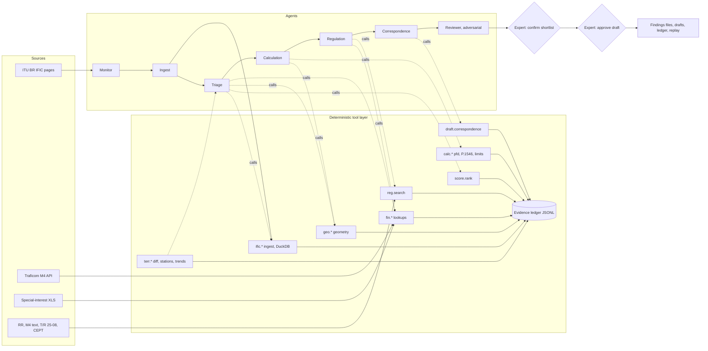

# Solution 02: Agentic Analyst Workflow (tool-using LLM agents with auditable traces)

> [!NOTE]
> Thesis: a small team of LLM agents does the analyst's reasoning (what to look at next, what it means, what to write), but every number, lookup and comparison comes from a deterministic tool whose call and result are written to an append-only evidence ledger. The single bet is that an expert trusts a conclusion they can replay step by step more than a conclusion that arrived as a block of text, and that the same agents with a different toolset carry the architecture from space filings to terrestrial land-mobile notices without a second build.

Source tags: `[BRIEF]` official brief, `[README]` repo README, `[FACTS]` from `solutions/00_shared_facts.md` with its URL, `[HYPOTHESIS]` reasoned but unverified, `[GAP - ASK PARTNER]` must be asked at the Q&A stand.

## 1. Summary

**What it is.** A workflow of six agents (Monitor, Ingest, Triage, Calculation, Regulation, Correspondence) plus an adversarial Reviewer agent, run inside a fixed workflow graph. Each agent has a system prompt, a tool subset and a step budget. The tools are plain Python functions: SQL over the ingested IFIC data, a pfd calculator, a P.1546 calculator, an M4 lookup, a special-interest station lookup, a regulation retriever, an IFIC-to-IFIC diff, a ranking function and a correspondence template filler. Every tool call is a ledger entry; every finding must cite ledger entries; the run can be replayed from the ledger without the model.

**Who uses it.** A Traficom spectrum specialist who opens a run for a new IFIC, reads the ranked findings with their evidence chains, approves or dismisses each, and edits the correspondence draft before anything leaves the building `[BRIEF]`.

**What it outputs.** A ranked findings file per IFIC (the Space IFIC 3074 and Terrestrial IFIC 3076 result files required by the brief `[BRIEF]`), one correspondence draft per confirmed concern with the counterparty administration identified, the evidence ledger (JSONL), and a replay command that reproduces the run.

**Why it scores.** Criterion C (usefulness and innovation) because the agents produce a prioritised, explained queue rather than a dump; B (extensibility) because the terrestrial side quest is the same graph with a different toolset; E (auditability) because provenance is a by-product of the tool layer, not an afterthought. The weak spot is A (reproducibility of LLM-chosen paths), addressed in section 6 with temperature 0, cached tool results, replay and the rule that no number may originate in the model.

## 2. Requirements map

| Brief workflow step | Component or mechanism | Status | Notes |
|---|---|---|---|
| Ingest national info: M4 table | Tool `fin.lookup_allocation` over a cached copy of the Traficom API `[FACTS]` | core | 5,917 OData rows, capitals in `Services_in_Finland` = primary (https://opendata.traficom.fi/api/v13/Taajuusjakotaulukko) `[FACTS]` |
| Ingest national info: special-interest XLS | Tool `fin.special_interest_stations` reading the XLS from the Since AI platform `[BRIEF]` | core | Columns per brief: station number, centre frequency, bandwidth, coordinates, antenna height, direction, directivity `[BRIEF]` |
| Ingest national info: M15 | Regulation corpus for `reg.search` | stretch | Brief says less relevant `[BRIEF]` |
| Detect and retrieve new IFICs | Monitor agent with `ific.list_issues` and `ific.fetch` | core | Scraper over the ITU BR IFIC pages; manual drop-in folder as fallback `[HYPOTHESIS]` |
| Ingest Space IFIC (API/A, CR/C, AP30/30A/30B) | Ingest agent, `ific.load` (mdbtools export to DuckDB) | core | SRS MDB tables notice, grp, freq, s_beam, emiss, geo, orbit, non_geo, srv_area, srv_cls, provn, pub_ssn `[FACTS]` https://www.itu.int/en/ITU-R/software/Documents/spaceqry/srs_dbv6.pdf |
| Identify interesting satellite systems | Triage agent with `space.list_notices`, `fin.lookup_allocation`, `geo.*`, `score.rank` | core | Ranking from the scoring package (section 5) |
| pfd calculation, GSO and NGSO | Calculation agent with `calc.pfd_gso`, `calc.pfd_ngso_worst`, `calc.pfd_limit`, `calc.pfd_margin` | core | NGSO as labelled worst case (section 6) |
| Summarise relevant content and frequency ranges | Triage agent output schema `Shortlist` | core | Text generated only from ledger entries |
| Cross-compare with M4/M15 and special-interest table | `fin.*` tools, Regulation agent | core | |
| Identify items concerning Finland | Finding schema with priority A/B/C | core | Thresholds in `weights.json` of the scoring package |
| Explain concerns with calculations | Calculation agent plus number audit (section 7) | core | |
| Identify counterparty administration | `space.counterparty` from `notice.adm` and the ITU administration symbol list | core | Where the BR's affected-administration list sits in the MDB is open `[GAP - ASK PARTNER]` |
| Draft correspondence template | Correspondence agent with `draft.correspondence` | core | Human checkpoint before export |
| Space IFIC 3074 result file | `export.results space 3074` | core | Published 2026-06-23, 4-month comment windows `[FACTS]` |
| Terrestrial: diff consecutive IFICs | `terr.diff_issues` over two `BRIFIC_nnnn.db3` files | core | SQLite TerRaBase since IFIC 3042 `[FACTS]` https://www.itu.int/ITU-R/terrasys/docs/db/structure |
| Terrestrial: filter foreign land-mobile assignments relevant to Finland | Triage agent with `terr.get_station`, `geo.distance_to_finland`, `fin.lookup_allocation` | core | |
| Terrestrial: determine ITU/CEPT/national framework | Regulation agent with `reg.search` | core | |
| Terrestrial: identify criterion (ECC T/R 25-08) | `calc.tr2508_trigger` | core | Annex 1 triggers `[FACTS]` https://docdb.cept.org/download/4789 |
| Terrestrial: P.1546 field strength | `calc.p1546_field_strength` | core | Reference implementation port, section 6 |
| Terrestrial: expert-reviewable findings with parameters and citations | Same Finding schema, terrestrial fields | core | |
| Terrestrial IFIC 3076 result file | `export.results terrestrial 3076` | core | |
| Trends and anomalies in neighbouring administrations' notices | `terr.trends` (deterministic statistics) narrated by the Triage agent | core, small | New activity by band, geography, station class, bandwidth `[BRIEF]` |

## 3. Architecture

The workflow graph is fixed code. Agency lives inside the nodes: within a node the agent chooses which tools to call, in which order and how many times, under a budget. The graph never lets an agent skip a human checkpoint or write a finding without ledger citations.



**Deterministic code** (no model involved): downloading and hashing IFIC files; exporting MDB and SQLite tables into DuckDB; every SQL query; frequency overlap arithmetic; GSO elevation and slant range; pfd, limits and margins; P.1546; T/R 25-08 thresholds; IFIC diffs; trend statistics; the scoring formula; the ledger; template filling; exports; replay.

**The LLM does**: decide which notices deserve a deeper look and why; decide which tools to call next for a given notice; write the plain-language reason for each finding from the cited ledger entries; determine the applicable regulatory framework by reading retrieved passages; draft the prose paragraphs of the correspondence; and, as Reviewer, try to refute each finding.

**Runtime.** Python 3.12, the Anthropic SDK with tool use and structured outputs, `claude-sonnet-5-5` for all agents by default and `claude-opus-5-5` for the Reviewer and for the Regulation agent when a framework question is hard; temperature 0; prompts and tool schemas versioned in the repo and hashed into the ledger. The `LLMClient` interface takes a message list and a tool list and returns tool calls or a structured object, so a local open-weight model served through an OpenAI-compatible endpoint with tool calling can be substituted by configuration `[HYPOTHESIS: which local model handles tool calls reliably enough is untested]`.

## 4. Data ingestion

**Space IFIC.** The issue is downloaded from the ITU space BR IFIC page `[BRIEF]` into `data/partner/space/<ific_no>/` (git-ignored) and hashed. The SRS-format MDB is exported table by table with `mdb-export` from mdbtools (`brew install mdbtools` on macOS) into CSV and loaded into DuckDB as `space_<ific_no>.*` `[HYPOTHESIS: mdbtools handles this MDB version; fallback is UCanAccess via JDBC or the team member with Windows exporting from Access]`. Tables of interest: `notice` (notice id, administration, network name, notification reason and date), `grp` (frequency groups per beam), `freq` (assigned frequencies), `s_beam` (beam identity and gain), `emiss` (emission designators and power densities), `geo` and `orbit` and `non_geo` (orbital data), `srv_area` (service areas), `srv_cls` (service class), `provn` (provision under which the notice is submitted), `pub_ssn` (the special section the notice was published in) `[FACTS]` https://www.itu.int/en/ITU-R/software/Documents/spaceqry/srs_dbv6.pdf. The exact column names are read from the srs_dbv6.pdf description at ingest time and recorded in `data/schema/space_srs_v6.json`; any column the plan names below that is not found is reported by the Ingest agent instead of guessed. The special sections API/A, CR/C and AP30/30A/30B are selected through `pub_ssn` `[HYPOTHESIS: column semantics to confirm against the PDF]`. The PDF special sections are not parsed in the core path; if a field is missing from the database, the Ingest agent may call `pdf.extract(section, page)` to pull text, and the resulting ledger entry carries the page number so the expert can check.

**Terrestrial IFIC.** Each issue is a SQLite file `BRIFIC_<nnnn>.db3` (TerRaBase, since IFIC 3042 of 2025-03-18) with the FXM domain tables `fxm_terra`, `fxm_ant`, `fxm_tx`, `fxm_rx`, `fxm_geo` `[FACTS]` https://www.itu.int/ITU-R/terrasys/docs/db/structure. DuckDB attaches the SQLite file directly, so no export step is needed. Land-mobile notices are the T12 notices; their item keys include `t_freq_assgn`, `t_lat` (signed DDMMSS), `t_pwr_dbw` with `t_pwr_eiv` (power value and its type), `t_hgt_agl` (antenna height above ground), `t_azm_max_e` (azimuth of maximum e.r.p.) `[FACTS]` same URL. Two consecutive issues are needed for the diff (3075 and 3076, or whichever pair the extract page provides) `[GAP - ASK PARTNER: which consecutive issues are downloadable without a TIES account]`.

**M4.** The Taajuusjakotaulukko API returns 5,917 rows through OData paging (`$top`, `$skip`); capitalised service names in `Services_in_Finland` denote primary allocations `[FACTS]`. The table is fetched once, stored as `data/reference/taajuusjakotaulukko_<date>.json.gz` with its fetch timestamp, and indexed by frequency range. The snapshot from 2026-11-06 already exists on the scoring branch and is reused `[FACTS]`.

**Special-interest XLS.** Read with openpyxl into `special_interest_stations` with columns normalised to MHz, kHz, decimal degrees and metres; the original cell references are kept per row for citation.

**Regulatory corpus.** RR Article 21 Table 21-4 as a JSON table with a `verified` flag per row (the scoring branch already holds this table with some rows marked unverified `[FACTS]`), T/R 25-08 Annex 1 as a JSON table `[FACTS]` https://docdb.cept.org/download/4789, the M4 regulation text and the T/R 25-08 PDF chunked into passages with page anchors for `reg.search`. CEPT docdb implementation pages are fetched only if time allows `[HYPOTHESIS]`.

**Fallbacks.** If the MDB cannot be exported by Saturday 01:00, the team member with Windows exports CSV from Access; if no one has Windows, the Ingest agent works from the PDF special sections with `pdf.extract` for the subset of notices that mention frequency bands overlapping Finnish primary allocations, clearly marked as a reduced-coverage run. If the terrestrial extract is a single issue only, the diff degrades to "all notices in the issue" and the finding type says so.

## 5. Relevance detection for Finland (space)

The Triage agent works notice by notice on the special sections API/A, CR/C and AP30/30A/30B, but every test it applies is a tool result:

1. **Frequency overlap.** `fin.lookup_allocation(f_min, f_max)` returns the M4 rows overlapping each `grp` frequency range, with service, primary/secondary status and footnotes `[FACTS]`; `fin.special_interest_stations(f_min, f_max)` returns the protected stations whose centre frequency plus or minus half bandwidth overlaps the group `[BRIEF]`. Overlap is computed in Hz by the tool; adjacent-band proximity within a configurable guard (default 10 percent of the group bandwidth `[HYPOTHESIS]`) is reported as "adjacent" rather than "overlap".
2. **Geography.** For GSO networks, `geo.gso_visible_from_finland(sat_lon)` samples 24 points across Finland and returns the minimum and maximum elevation angle; a satellite below 0 degrees everywhere is not relevant for downlink pfd. For NGSO networks, `geo.ngso_covers_finland(inclination, altitude)` returns true when the inclination plus the angular radius of the coverage at the given altitude reaches 60 degrees north or more `[HYPOTHESIS: a coarse geometric gate; refine with srv_area when present]`. Service areas in `srv_area` are tested against the Finland polygon with Shapely.
3. **Direction.** Space-to-Earth groups threaten terrestrial receivers in Finland (pfd); Earth-to-space groups matter when Finnish satellites or Finnish earth stations share the band `[HYPOTHESIS: which Finnish networks exist in the SRS is open]` `[GAP - ASK PARTNER]`.
4. **Stage and urgency.** `notice.ntf_rsn` or `provn` give the stage; API/A and CR/C comment windows are 4 months from publication `[FACTS]`, so a notice from IFIC 3074 (published 2026-06-23) has its window closing around 2026-10-23, which the finding states explicitly.
5. **Ranking.** `score.rank(findings)` calls the existing scoring package (`rank_groups`, `rank_notices`): score = 100 x relevance x (0.65 severity + 0.35 urgency), where relevance = freq_overlap x geography x direction as multiplicative gates, with priority A at 70 and above, B at 45, C at 20, and all weights in `weights.json` `[FACTS]` (branch `claude/folder-scoring-system-a430c2`, 52 unit tests). The agent cannot change a score; it can only ask for a recomputation with a documented override that becomes a ledger entry for the expert to see.

The agent's own contribution is the shortlist decision and its reasons: it reads the tool outputs and emits a `Shortlist` object listing which notices go to calculation and which are dismissed with a one-line reason that must quote a ledger entry id. Dismissals are kept in the output so the expert can audit false negatives.

## 6. Technical calculations

All formulas are implemented in `tools/calc.py` with unit tests and a `test_vectors.json` file; every result carries the formula id, the inputs and the code version.

**GSO geometry** `[HYPOTHESIS: standard textbook geometry, verify against an ITU example]`. For a ground point at latitude phi and longitude lambda and a satellite at longitude lambda_s, with R_e = 6378.137 km and r = 42164.2 km:

```
cos(gamma) = cos(phi) * cos(lambda - lambda_s)
elevation  = atan2( cos(gamma) - R_e / r , sqrt(1 - cos(gamma)^2) )        [degrees after conversion]
slant d    = R_e * ( sqrt( (r / R_e)^2 - cos(elevation)^2 ) - sin(elevation) )   [km]
```

Illustration: Helsinki (60.17 N, 24.94 E) towards a satellite at 25 E gives an elevation near 22 degrees and a slant range near 39,400 km.

**pfd at the ground** `[HYPOTHESIS: formula is standard; reference bandwidth and the power density column must be confirmed]`:

```
pfd [dB(W/m^2) in B_ref] = EIRP_density [dBW in B_ref, towards the point] - 10 * log10(4 * pi * d^2)   with d in metres
EIRP_density = pwr_ds_max [dB(W/Hz)] + 10 * log10(B_ref [Hz]) + G_beam(theta) [dBi]
```

The worst case uses the beam's maximum gain (`s_beam` maximum gain) and the maximum power density (`emiss` maximum power density column) `[HYPOTHESIS: column names]`; the Calculation agent must label this "worst case, maximum gain towards Finland" and may call `calc.pfd_gso` again with the gain at the edge of the service area when `srv_area` shows Finland outside it. For the slant range above, 10 log10(4 pi d^2) is about 162.9 dB, so an EIRP density of, for example, 10 dBW per 4 kHz gives a pfd of about -152.9 dB(W/m^2) per 4 kHz.

**Limits.** `calc.pfd_limit(freq_mhz, elevation_deg, service)` looks up RR Article 21 Table 21-4 by band and returns the limit for the elevation range 0 to 5, 5 to 25 or 25 to 90 degrees with the reference bandwidth and the row's `verified` flag `[FACTS]`. Example row as stored, to be verified: 3,400 to 4,200 MHz, -152 dB(W/m^2) per 4 kHz below 5 degrees, -152 + 0.5 (delta - 5) between 5 and 25 degrees, -142 above 25 degrees `[HYPOTHESIS]`. `calc.pfd_margin` returns limit minus pfd in dB; a negative margin is an exceedance. AP30/30A/30B plan limits are a separate table filled only for the bands the expert names at the Q&A `[GAP - ASK PARTNER]`.

**NGSO.** `calc.pfd_ngso_worst(altitude_km, pwr_density, gain_max, B_ref)` evaluates the pfd at the sub-satellite point (d = altitude) and at 5 degrees elevation, and reports both as "indicative worst case, no time percentage, no epfd aggregation" so the expert knows it is a screening value, not an Article 22 epfd result `[HYPOTHESIS]`.

**P.1546 field strength (terrestrial).** `calc.p1546_field_strength(freq_mhz, distance_km, h1_m, erp_dbw, time_pct, path, h2_m)` wraps a port of the ITU-R SG3 reference implementation (the `Py1546` repository by Ivica Stevanovic, https://github.com/eeveetza/Py1546 `[HYPOTHESIS: repository name and licence to verify before use]`), validated against its published test vectors. Output:

```
E [dB(uV/m)] = E_1kW(f, d, h1, t, path, h2) + (erp_dbw - 30)
erp_dbw = eirp_dbw - 2.15     when the notice gives e.i.r.p. instead of e.r.p.
```

Inputs come from the T12 notice: frequency from `t_freq_assgn`, power from `t_pwr_dbw` interpreted through `t_pwr_eiv`, antenna height from `t_hgt_agl` used as h1 in the absence of terrain data (labelled as such), distance from `geo.distance_to_finland` to the nearest Finnish border point along `t_azm_max_e` or the shortest path `[FACTS]` for the field names, `[HYPOTHESIS]` for the interpretation. Time percentage 10, receiving height 10 m, path land or sea chosen by the great-circle crossing.

**T/R 25-08 trigger.** `calc.tr2508_trigger(freq_mhz, channel_khz)` returns the Annex 1 coordination trigger: 0, 6, 12, 18 or 20 dB(uV/m) per 25 kHz at 10 m height for 10 percent of time in the bands 29.7 to 47, 47 to 108, 108 to 380, 380 to 400 and 400 to 470 MHz, plus 10 log10(channel_khz / 25) `[FACTS]` https://docdb.cept.org/download/4789. The finding reports E at the border, the trigger, and the margin.

**Labelling.** Every calculated value carries `indicative: true` unless the expert has confirmed the method; the UI shows the formula and inputs on hover; exports include them as columns.

**Reproducibility.** Tool code is pure and versioned; tool results are cached by hash of (tool, inputs, code version); agent runs use temperature 0 and a fixed prompt version; `analyst replay --run <id>` re-executes the ledger with cached tool outputs and checks every hash, and `analyst replay --live` recomputes tools and reports any drift. Two runs on the same IFIC with the same prompt and code versions produce identical ledgers in the deterministic parts; where the model's tool-call order differs, the findings are compared by content and the diff is printed, so the team can state honestly in the submission how stable the agent paths were on 3074 and 3076.

## 7. AI components and guardrails

| Agent | Model | Tools | Budget | Output schema |
|---|---|---|---|---|
| Monitor | sonnet | `ific.list_issues`, `ific.fetch` | 10 calls | `IssueManifest` |
| Ingest | sonnet | `ific.load`, `sql.query` (read-only), `pdf.extract` | 30 calls | `IngestReport` with row counts and missing columns |
| Triage | sonnet | `space.list_notices`, `space.get_network`, `fin.*`, `geo.*`, `score.rank`, `terr.*` | 8 calls per notice, 400 per run | `Shortlist` |
| Calculation | sonnet | `calc.*`, `geo.*` | 12 calls per notice | `CalcResult[]` |
| Regulation | sonnet, opus on escalation | `reg.search`, `fin.lookup_allocation` | 10 calls per finding | `Framework` with clause citations |
| Correspondence | sonnet | `draft.correspondence`, `space.counterparty` | 4 calls per finding | `Draft` |
| Reviewer | opus | read-only access to the ledger and all tools | 10 calls per finding | `Verdict` (refuted, weak, holds) |

**Grounding rules enforced in code, not in prompts.**

- A `Finding` is rejected by the validator unless every `evidence_entry_ids` entry exists in the ledger of the same run.
- Number audit: every number in a finding's explanation or a draft's prose is extracted by regex and must appear (within formatting tolerance) in the outputs of a cited ledger entry; otherwise the object is returned to the agent once with the offending numbers listed, and on a second failure the finding is flagged "needs expert" and the prose is replaced by the tool outputs verbatim.
- Agents never see raw PDFs or web pages except through `pdf.extract` and `reg.search`, whose outputs are ledger entries with page anchors.
- Agents cannot write files, call the network or run code; only tools can.
- The Correspondence agent fills only the prose placeholders of a fixed template; counterparty, notice ids, frequencies, pfd values and provisions are inserted by `draft.correspondence` from the ledger.
- Uncertainty: when a tool returns null (missing column, no service area), the agent must emit `unknown` for that factor; the scoring package treats unknown geography as a reduced, not zero, gate and marks the finding "incomplete data" `[FACTS]` for the gate design.
- The Reviewer is prompted to refute: it re-queries the tools, tries the opposite assumption (edge-of-beam gain, actual service area, secondary status in M4) and returns a verdict with its own ledger citations; findings it refutes are shown to the expert in a separate "contested" list rather than deleted.

**Substituting the model.** `LLMClient` has one method `complete(messages, tools, schema)`; the Anthropic implementation uses native tool use and structured outputs; an OpenAI-compatible implementation targets a local server (vLLM or Ollama) `[HYPOTHESIS]`. Prompts avoid provider-specific features. The demo cache (section 11) means the demo runs with no model at all if required.

## 8. Auditability and evidence model

**Ledger entry** (JSONL, append-only, one file per run):

```json
{
  "entry_id": "e-000123",
  "run_id": "run-3074-20261107-0915",
  "seq": 123,
  "agent": "calculation",
  "tool": "calc.pfd_gso",
  "tool_version": "0.3.1",
  "inputs": {"pwr_ds_max_dbw_hz": -56.0, "gain_dbi": 36.0, "b_ref_hz": 4000, "sat_lon": 25.0, "lat": 60.17, "lon": 24.94},
  "output": {"pfd_dbw_m2": -146.9, "elevation_deg": 21.8, "slant_km": 39385, "formula": "pfd-gso-v1"},
  "output_hash": "sha256:...",
  "sources": [
    {"kind": "ific", "locator": "space/3074/emiss#ntc_id=123456789;emi_id=3"},
    {"kind": "ific", "locator": "space/3074/s_beam#ntc_id=123456789;beam=KA1"}
  ],
  "parents": ["e-000098", "e-000101"],
  "model": null,
  "prompt_hash": null,
  "cached": false
}
```

LLM decisions are also entries: `tool` is `llm.decide`, `model` and `prompt_hash` are filled, `inputs` hold the message digest and `output` the structured object.

**Finding** (the unit the expert reviews):

```json
{
  "finding_id": "f-3074-0007",
  "run_id": "run-3074-20261107-0915",
  "ific": {"kind": "space", "no": 3074, "published": "2026-06-23"},
  "notice": {"ntc_id": "123456789", "adm": "AUS", "network": "EXAMPLE-SAT-1", "section": "CR/C", "stage": "coordination"},
  "kind": "pfd_exceedance",
  "claim": "Downlink group 3,700 to 4,200 MHz exceeds the Article 21 pfd limit over southern Finland by 3.3 dB under worst-case gain.",
  "factors": {"freq_overlap": 1.0, "geography": 0.9, "direction": 1.0, "severity": 0.8, "urgency": 0.6},
  "score": 78, "priority": "A",
  "evidence_entry_ids": ["e-000098", "e-000101", "e-000123", "e-000124", "e-000130"],
  "citations": [
    {"kind": "ific", "locator": "space/3074/grp#ntc_id=123456789;grp_id=2"},
    {"kind": "m4", "locator": "taajuusjakotaulukko_2026-11-06#row=2210"},
    {"kind": "regulation", "locator": "RR Art. 21 Table 21-4, row 3400-4200 MHz, verified=false"}
  ],
  "indicative": true,
  "reviewer": {"verdict": "holds", "entry_ids": ["e-000140"]},
  "human": {"status": "pending", "by": null, "at": null, "note": null}
}
```

**Citation format.** `source kind / issue / table # key=value` for IFIC data, API snapshot and row id for M4, cell reference for the XLS, document, article, table and row for regulations with the verified flag visible. The UI renders each citation as a link that opens the exact row or passage.

**How an expert verifies a conclusion.** Open the finding, follow the evidence chain in order (lookup, geometry, calculation, limit, margin), see the inputs and formula of each step, click the source row, and if in doubt run `analyst replay --run <id> --finding f-3074-0007 --live` to recompute that finding from the sources on their own machine.

## 9. Terrestrial side quest

The graph, the agents, the ledger, the Finding schema, the Reviewer and the UI are unchanged. What changes is the toolset bound to the run and three prompt sections (what "relevant" means, which framework to consult, which calculation to call).

- **Diff consecutive issues** `[BRIEF]`: `terr.diff_issues(ific_a, ific_b, {adm: neighbours, notice_type: "T12"})` attaches both SQLite files in DuckDB and returns added, modified (with the changed columns) and withdrawn assignments keyed by the notice identifier `[HYPOTHESIS: the exact key columns and the way suppressions are represented must be read from the terrasys structure docs]`. Neighbours default to Sweden, Norway, Estonia and Russia by their ITU symbols `[HYPOTHESIS: symbols S, NOR, EST, RUS]`.
- **Filter foreign assignments relevant to Finland** `[BRIEF]`: Triage calls `geo.distance_to_finland(lat, lon)` and `fin.lookup_allocation(freq)`; the gate is distance under a configurable 150 km `[HYPOTHESIS]` or any assignment whose P.1546 field strength at the border could plausibly reach the trigger (a quick free-space pre-check), plus a frequency overlap or adjacency with a Finnish primary allocation or a special-interest station.
- **Determine the framework** `[BRIEF]`: Regulation agent retrieves from the corpus: RR Article 11 notification context, T/R 25-08 as the CEPT coordination recommendation for land mobile in 29.7 to 470 MHz `[FACTS]`, the M4 rows and any bilateral arrangement Traficom names `[GAP - ASK PARTNER]`; it emits a `Framework` object with clause citations.
- **Identify the criterion** `[BRIEF]`: `calc.tr2508_trigger` as in section 6; where the band is outside T/R 25-08, the finding says "no CEPT trigger found; expert criterion needed" rather than inventing one.
- **Calculate field strengths deterministically with P.1546** `[BRIEF]`: `calc.p1546_field_strength` at the nearest border point and at the nearest special-interest station; both values, all inputs and the model version go into the finding.
- **Expert-reviewable findings** `[BRIEF]`: same Finding schema with a `terrestrial` block: source notice key, administration, station class, coordinates, frequency, bandwidth, power type and value, antenna height, azimuth, computed E at border, trigger, margin, assumptions (h1 equals height above ground, no terrain, 10 percent time, 10 m receiver).
- **Trends and anomalies** `[BRIEF]`: `terr.trends(adm_list, issues)` computes per administration and issue the counts and bandwidth sums by band, station class and 50 km border segment, and flags z-scores above 2 over the available history `[HYPOTHESIS: history depth depends on how many issues can be downloaded]`; the Triage agent writes a five-line narrative citing the statistics entries.

Simplifications that are explicit in the output: no terrain profile, no clutter, no antenna pattern beyond azimuth of maximum e.r.p., no aggregation across stations. Each appears in the finding's assumptions list so the expert can judge the screening value.

## 10. Outputs and deliverables

- `results/space_ific_3074/findings.csv` and `.json`: one row per finding with columns `finding_id, priority, score, ntc_id, adm, network, section, stage, freq_min_mhz, freq_max_mhz, direction, m4_services, m4_status, special_interest_station_ids, elevation_min_deg, elevation_max_deg, pfd_worst_dbw_m2, pfd_limit_dbw_m2, limit_ref_bw, margin_db, limit_verified, indicative, reviewer_verdict, claim, evidence_entry_ids, citations` and a companion `dismissed.csv` with the dismissal reasons. A `README.md` in the folder states the run id, code version, prompt versions, model ids, tool cache state, and the replay command `[BRIEF: results for 3074 must be submitted separately]`.
- `results/terrestrial_ific_3076/findings.csv` and `.json`: columns `finding_id, priority, score, change_type (new/modified/withdrawn), notice_key, adm, station_class, lat, lon, freq_mhz, bandwidth_khz, power_dbw, power_type, antenna_height_m, azimuth_deg, distance_to_border_km, e_border_dbuv_m, trigger_dbuv_m, margin_db, framework_citations, assumptions, reviewer_verdict, claim, evidence_entry_ids` plus `trends.md` with the anomalies and their statistics entries.
- `results/<run>/drafts/<finding_id>.md`: correspondence draft with header (to the administration identified by `space.counterparty`, reference to the special section and notice id, the provision invoked, the comment deadline), a parameters table copied from the ledger, the technical concern paragraph written by the agent from cited entries, a request paragraph (to be included in coordination, or to receive additional data), and a signature block left empty for the expert. A SpaceCom-compatible comment export is a stretch item `[GAP - ASK PARTNER: which format Traficom actually submits]`.
- `results/<run>/ledger.jsonl` and `replay.sh`.
- `docs/io.md`: the input/output description the brief asks for `[BRIEF]`: sources with URLs and hashes, the schema files, the result file columns, the formulas, the prompt versions.

Repository layout:

```
analyst/           agents, graph, llm_client, validators, replay
tools/             ific, space, terr, fin, geo, calc, reg, score, draft, export
data/              reference (M4 snapshot, tables), schema, partner (git-ignored), cache
results/           per-IFIC outputs
frontend/          run viewer and review UI
tests/             tool unit tests, test vectors, ledger validation, golden runs
docs/              io.md, prompts/, evaluation notes
```

## 11. Human-in-the-loop UI

One screen with three panes. Left: the run timeline, one row per ledger entry grouped by agent, with the current step highlighted while a run is live. Centre: the findings queue sorted by priority, each card showing the claim, the score factors, the margin, the reviewer verdict and the evidence chain as numbered steps; clicking a step opens the source row or passage. Right: the correspondence draft for the selected finding in an editor, with the ledger-filled fields locked and the prose fields editable.

Expert actions: Approve, Dismiss, Investigate, Edit draft, Export. Each action is a ledger entry with the reviewer name and time; nothing is sent anywhere `[BRIEF: human experts in control]` `[README]`. Two checkpoints block the graph: the shortlist is shown before the calculation phase on the first run of an IFIC (the expert can add or remove notices), and every draft must be approved before export. A Demo Mode switch serves the cached ledgers of 3074 and 3076, so the demo and the video do not depend on the API. The UI uses the repo's design system (`design/girlypop.css`, risk tokens, no playful copy on findings).

## 12. Tech stack

- Python 3.12, `anthropic` SDK (tool use, structured outputs), Pydantic v2 for every schema, DuckDB for all queries (reads CSV exports and attaches SQLite), mdbtools for the MDB export `[HYPOTHESIS]`, Shapely and pyproj for geometry with a Natural Earth Finland polygon, numpy, openpyxl, the Py1546 port `[HYPOTHESIS]`, pytest.
- FastAPI for the run API and server-sent events for the live timeline; React with Vite, TypeScript, shadcn/ui and Tailwind v4 with the Girlypop tokens for the UI; Streamlit as the fallback if the frontend slips past Gate 3.
- Models: `claude-sonnet-5-5` default, `claude-opus-5-5` for Reviewer and escalations; prompt caching for the system prompts and tool schemas; a local OpenAI-compatible endpoint as an alternative client.
- Why: DuckDB removes a database server and gives one query language over MDB exports and SQLite; Pydantic validators are where the grounding rules live; the Anthropic SDK's structured outputs make the "no free-form numbers" rule enforceable.

## 13. Build plan: Fri 19:30 to Sun 10:00

| Sprint | Time | Focus | Owner | Gate |
|---|---|---|---|---|
| S1 | Fri 19:30 to 23:30 | Download Space 3074 MDB and the terrestrial extract; mdbtools export to DuckDB; M4 snapshot and XLS loaded; tool layer skeleton with `sql.query`, `fin.*`, `geo.gso_*`; ledger writer; one agent (Triage) looping on 20 notices | BE data, AI agent loop, FE scaffold, PM Q&A list | Gate 1 at 22:30: SQL over notice, grp, freq works; if not, Windows export or PDF path chosen |
| S2 | Fri 23:30 to Sat 03:30 | `calc.pfd_*`, `calc.pfd_limit`, `score.rank` wired to the scoring package; Calculation agent; Finding validator and number audit; first findings on 3074 | AI, BE | Findings JSON validates |
| Rest | Sat 03:30 to 07:30 | Sleep rotation, two awake on ingest bugs | | |
| S3 | Sat 07:30 to 11:30 | Regulation and Correspondence agents; counterparty tool; run viewer showing the ledger live. Q&A at 10:00 to 11:00 with the space specialists: confirm Table 21-4 rows and reference bandwidths, which column holds the affected administrations, meaning of CR/D, CR/E, CR/F, which Finnish networks to protect, what a comment letter contains | AI, FE, PM | Gate 2 at 09:00: end-to-end on 3074 in the UI |
| S4 | Sat 11:30 to 15:30 | Terrestrial toolset: SQLite attach, `terr.diff_issues`, T12 parsing, `calc.p1546_*`, `calc.tr2508_trigger`; Q&A at 11:00 to 12:00 with the terrestrial specialists: which issues to diff, power field semantics, bilateral criteria, border reference points. Reviewer agent | BE, AI, PM | Terrestrial findings on 3076 |
| S5 | Sat 15:30 to 19:30 | Human checkpoints, replay command, tool cache, exports for 3074 and 3076; second Q&A slots at 16:00 to 17:00 (terrestrial) and 17:00 to 18:00 (space) to review a printed sample of findings | all | Gate 3 at 16:00: both result files exist, even if rough |
| S6 | Sat 19:30 to 23:30 | `terr.trends`, correspondence drafts for the top findings, golden cases as tests, docs/io.md, false-positive pass with the expert feedback | AI, BE, PM | |
| S7 | Sat 23:30 to Sun 03:30 | Freeze at 02:00; Demo Mode cache of both runs; README setup under five minutes; results README with versions | all | Gate 4 at 02:00 |
| Rest | Sun 03:30 to 06:30 | Sleep rotation | | |
| S8 | Sun 06:30 to 10:00 | Video in Demo Mode, deck, final result files, submission by 09:15 | PM, FE | Gate 5 at 08:00; never miss 10:00 |

Kill and pivot rules: if by Gate 1 no SQL works, the space path runs on PDF extraction with reduced coverage and the terrestrial path (SQLite, no export needed) becomes the primary demo. If the agent loop is unstable by Gate 2, the Triage and Calculation nodes run as scripted tool sequences and only the explanation and correspondence remain agentic, which keeps the ledger and the UI intact. If the Reviewer costs too much time, it runs only on priority A findings.

## 14. Risks and fallbacks

| Risk | L | I | Trigger | Fallback |
|---|---|---|---|---|
| MDB export fails on macOS | 3 | 5 | No tables by Fri 22:30 | Windows laptop export; PDF special-section extraction with reduced coverage, stated in the results README |
| Terrestrial extract lacks two consecutive issues | 3 | 4 | Download page shows one issue | Diff degrades to all notices; ask at 11:00 for an earlier issue |
| Agent takes different paths between runs | 4 | 3 | Replay diff non-empty | Temperature 0, tool cache, fixed phase order; report stability honestly |
| Model invents a number | 3 | 5 | Number audit failure | Validator rejects, retries once, then falls back to verbatim tool outputs |
| pfd column semantics wrong | 3 | 5 | Specialist disagrees at 10:00 | Column map is one JSON file; recompute all findings by replay |
| API outage during demo | 2 | 5 | Any call over 10 s in rehearsal | Demo Mode serves cached ledgers |
| Cost and latency of per-notice agent calls | 3 | 3 | Run over 20 minutes on 3074 | Pre-filter with the scoring gates before any agent call; batch notices per call |
| P.1546 port not validated | 2 | 4 | Test vectors fail | Use free-space plus a labelled correction as a screening value, flagged "not P.1546" |
| Scope creep from the agent framework | 3 | 3 | New agent proposed after Gate 3 | Six agents and the Reviewer are the ceiling |

## 15. Self-assessment against the evaluation criteria

| Criterion | Weight | Expected | Reason |
|---|---|---|---|
| A Technical analysis and reproducibility | 25 | 7 | Calculations are deterministic, versioned and replayable; the agent's path is not fully deterministic, and the plan says so |
| B Extensibility and terrestrial side quest | 25 | 9 | Terrestrial is the same graph, agents, ledger and UI with a different toolset; the side quest is covered bullet by bullet |
| C Workflow usefulness, innovation and output quality | 20 | 9 | Prioritised queue, evidence chains, adversarial reviewer, draft letters; realistic innovation |
| D Case recognition accuracy | 15 | 7 | Gates and scoring are sound but thresholds are untested on real data until Saturday; dismissals are visible for auditing false negatives |
| E Auditability and evidence quality | 15 | 9 | Provenance is produced by the tool layer; citations resolve to rows, cells and clauses; replay exists |

Weighted total: (7 x 25 + 9 x 25 + 9 x 20 + 7 x 15 + 9 x 15) / 10 = 82.

## 16. Demo script (2 minutes)

- 0:00 to 0:15. "Every two weeks the ITU publishes hundreds of satellite filings. A Traficom specialist has to find the few that threaten Finnish systems and answer within four months." Show the IFIC 3074 manifest in the Monitor pane.
- 0:15 to 0:40. Start the run in Demo Mode. The timeline fills: Ingest reports table counts, Triage dismisses notices with one-line reasons, the shortlist checkpoint appears. Click Confirm.
- 0:40 to 1:10. The top finding opens: a CR/C downlink group overlapping a Finnish primary allocation, elevation 22 degrees over Helsinki, worst-case pfd 3 dB over the Article 21 limit. Click each evidence step: the grp row, the M4 row, the formula with inputs, the limit row with its verified flag.
- 1:10 to 1:30. The Reviewer's verdict: "holds, but edge-of-beam gain reduces the margin to 0.4 dB". Click Approve; the audit entry appears. Open the draft letter to the administration, edit one sentence, export.
- 1:30 to 1:50. Switch to Terrestrial 3076: the diff shows new and modified land-mobile notices near the border, one finding with P.1546 field strength at the border against the T/R 25-08 trigger, and the trends panel.
- 1:50 to 2:00. "Same agents, same ledger, different tools. Every number has a source and every run replays." Show the replay command.

## 17. What makes this different from the other four approaches

- Deterministic pipeline (Solution 01): there, the order of analysis is fixed code and the model only writes prose at the end; here, the model chooses what to examine and which tools to call per notice, while the tools stay deterministic, so unusual filings get adaptive treatment and dismissals are explained.
- Knowledge graph (Solution 03): there, provenance comes from graph edges and relevance from pattern queries; here, provenance comes from the ledger of tool calls and relevance from agent decisions over tool results, with no graph store to build.
- ITU toolchain wrapper (Solution 04): there, the ITU's own software produces the numbers and the AI layer wraps it; here, the calculation tools are the team's own Python functions, portable to macOS and replayable, at the cost of not carrying the ITU tools' authority.
- Geospatial interference twin (Solution 05): there, a grid over Finland is the primary model and the map is the centre of the UI; here, the unit of analysis is the notice and the evidence chain, with geometry as one tool among many and a map only as a view.
