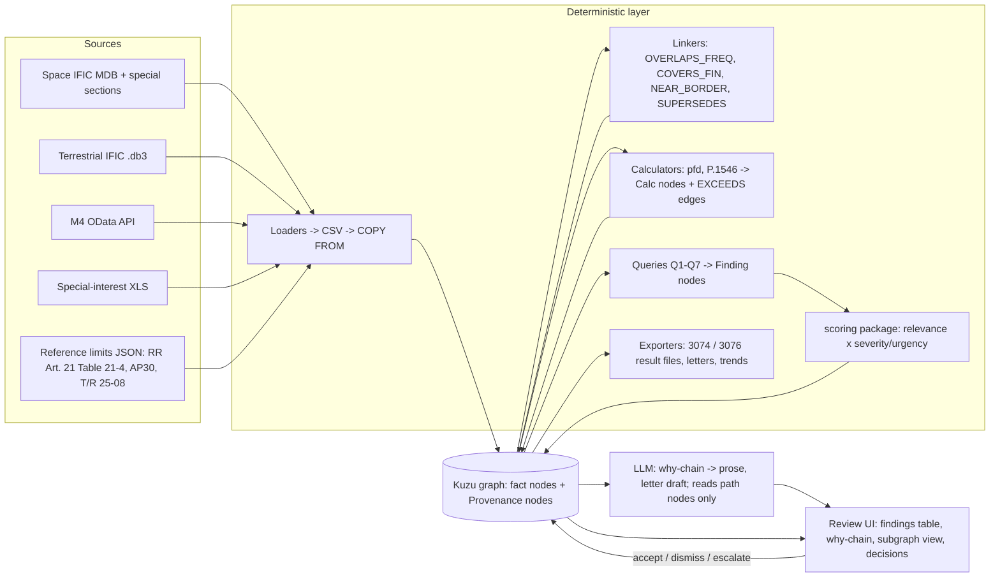

# Solution 03: Spectrum Knowledge Graph (semantic integration with provenance)

> [!NOTE]
> Thesis: load every source (Space IFIC database and special sections, Terrestrial IFIC, the Finnish M4 table, the special-interest station list, the regulatory limits) into one small typed graph where every fact node carries a provenance node, and let "relevant to Finland" be a handful of graph pattern queries. Calculations (pfd, P.1546 field strength) become computed nodes with their parameters attached. A finding is a path through the graph; the explanation an expert reads is that path rendered to text. The single bet: provenance and extensibility come for free from the data model, so the team spends its hours on sharp queries and correct numbers instead of on plumbing.

## 1. Summary

The product is a Spectrum Knowledge Graph (SKG) with a query layer and a small review UI. A Traficom spectrum specialist loads an IFIC issue number; loaders turn the issue's database into graph nodes and edges, link them to the Finnish allocation table and the special-interest stations through overlap and coverage edges, attach pfd or field-strength computations as nodes, and run a fixed set of queries that return findings ranked with the existing scoring package. The expert opens a finding, reads the why-chain (the exact path of nodes from the foreign notice to the Finnish allocation to the limit it exceeds), checks the source rows the path cites, and accepts, dismisses or escalates it. Accepted findings produce a draft letter to the counterparty administration, generated only from the nodes on the path.

Outputs: ranked findings per issue, the mandatory result files for Space IFIC 3074 and Terrestrial IFIC 3076 `[BRIEF]`, draft correspondence per accepted finding, a trends note for neighbouring administrations, and a reproducible graph build. It scores well because provenance is structural (criterion E), the terrestrial side quest is new node types and queries on the same graph rather than a second system (criterion B), and every number comes from a computed node whose inputs are visible (criterion A).

## 2. Requirements map

| Brief workflow step | Component or mechanism | Status | Notes |
|---|---|---|---|
| Ingest national info (M4 API, special-interest XLS, M15) | `load_m4.py` reads the Traficom OData API into `FinnishAllocation` nodes; `load_sis.py` reads the XLS into `SpecialInterestStation` nodes; M15 loaded as text footnotes only | core (M4, XLS), stretch (M15) | API returns 5917 rows, capitals in `Services_in_Finland` mark primary services `[FACTS]` https://opendata.traficom.fi/api/v13/Taajuusjakotaulukko |
| Detect and retrieve new IFICs (monitoring) | `watch_ific.py` polls the BR IFIC pages, compares the issue number to the highest `IficIssue` node, downloads and triggers a build | core (poll + build), stretch (scheduler) | Download may need a TIES login `[GAP - ASK PARTNER]` |
| Ingest Space IFIC (API/A, CR/C, AP30/30A/30B) | `load_srs.py` exports the SRS MDB tables to CSV with mdbtools and bulk-loads them | core | Tables `notice, grp, freq, s_beam, emiss, geo, orbit, non_geo, srv_area, srv_cls, provn, pub_ssn` `[FACTS]` https://www.itu.int/en/ITU-R/software/Documents/spaceqry/srs_dbv6.pdf |
| Identify interesting satellite systems | Query Q1 (frequency overlap and coverage gates) | core | Section 5 |
| pfd calculation (GSO and NGSO) | `calc_pfd.py` writes `Calc{method:"pfd_art21"}` nodes per group and representative point | core (GSO), core-indicative (NGSO) | Section 6 |
| Summarise relevant content and frequency ranges | LLM renders the why-chain of each finding; a per-issue digest query groups findings by band and administration | core | Section 7 |
| Cross-compare with M4/M15 and special-interest table | `OVERLAPS_FREQ` edges built by `link_overlaps.py` | core | Section 5 |
| Identify items concerning Finland | Queries Q1 to Q3 plus the scoring package | core | Section 5 |
| Explain concerns with calculations | Why-chain includes `Calc` and `Criterion` nodes with margins | core | Section 8 |
| Identify counterparty administration | `FILED_BY` edge to `Administration` | core | Section 10 |
| Draft correspondence template | `draft_letter.py`, LLM constrained to path nodes | core | Section 10 |
| Space IFIC 3074 result file | `export_results.py --issue 3074 --kind space` | core | Section 10 |
| Terrestrial: diff consecutive IFICs (new/modified/withdrawn) | `diff_issues.py` writes `Delta` nodes between issue subgraphs | core | Section 9 |
| Filter foreign land-mobile assignments relevant to Finland | Query Q4 (distance to border, band, class of station) | core | Section 9 |
| Determine ITU/CEPT/national framework | `Criterion` selection rules keyed on band, service and administrations | core | Section 9 |
| Identify criterion (ECC T/R 25-08) | `Criterion` nodes from T/R 25-08 Annex 1 `[FACTS]` https://docdb.cept.org/download/4789 | core | Section 6 |
| P.1546 field strength calculation | `calc_p1546.py` writes `Calc{method:"p1546"}` nodes | core | Section 6 |
| Expert-reviewable findings with parameters and citations | Finding nodes plus why-chains; export with parameters | core | Section 10 |
| Terrestrial IFIC 3076 result file | `export_results.py --issue 3076 --kind terrestrial` | core | Section 10 |
| Trends and anomalies in neighbouring administrations' notices | Query Q6 over `Delta` nodes grouped by administration, band, class, bandwidth | core (counts), stretch (z-scores over more than two issues) | Section 9 |

## 3. Architecture

Three layers. The deterministic layer (loaders, linkers, calculators, queries, exporters) is plain Python and Cypher and contains every number. The graph store holds data and provenance. The language-model layer only reads paths and writes prose.



Split of responsibilities:

| Deterministic code | LLM |
|---|---|
| Parsing, every node and edge, every overlap, every distance, elevation, pfd and field strength, every threshold comparison, the diff between issues, the ranking, the exports | Turning one why-chain into three paragraphs of prose; drafting the letter from the same chain; proposing (never applying) a label for a finding when a human asks "what would you call this" |

Graph store: Kuzu, an embedded graph database with Cypher and a Python package `[HYPOTHESIS: pip package `kuzu`; pin the version in `requirements.txt` on Friday night]`. Reasons: no server to run on hackathon laptops, bulk CSV loading, Cypher queries an expert can read in the UI, and a file on disk that is the reproducible artefact. Fallback if Kuzu misbehaves: NetworkX in memory with node and edge tables persisted in SQLite, and the same queries written as Python functions. The loaders write CSV first precisely so that either store can be fed.

Schema (kept deliberately small; every row of every CSV also gets a `Provenance` node):

| Node type | Key properties | Source |
|---|---|---|
| `IficIssue` | number, kind (space/terrestrial), published_date | IFIC file name and cover `[FACTS: 3074 published 2026-06-23]` |
| `SpecialSection` | type (API/A, CR/C, AP30/E, ...), ref, issue | `pub_ssn` `[FACTS table]`, column names `[HYPOTHESIS]` |
| `Administration` | symbol (FIN, S, NOR, EST, RUS ...) | `notice.adm` `[HYPOTHESIS column]`; symbols `[HYPOTHESIS]` |
| `Network` | ntc_id, sat_name, orbit_kind (GSO/NGSO), long_nom, ntf_rsn | `notice`, `orbit`, `non_geo` `[FACTS tables]` |
| `Beam` | beam_name, emi_rcp | `s_beam` `[FACTS table]` |
| `FreqGroup` | grp_id, freq_min_mhz, freq_max_mhz, direction, service_class, pwr_ds_max_dbw_hz, ref_bw_hz | `grp`, `freq`, `emiss`, `srv_cls` `[FACTS tables]`; property names `[HYPOTHESIS]` |
| `ServiceArea` | area_code, is_or_covers_fin | `srv_area`, `geo` `[FACTS tables]`; which codes cover Finland `[GAP - ASK PARTNER]` |
| `FinnishAllocation` | row_id, freq_min_mhz, freq_max_mhz, services, primary (bool), usage_text, footnotes | M4 API `[FACTS]` |
| `SpecialInterestStation` | station_no, centre_mhz, bandwidth_khz, lat, lon, ant_height_m, azimuth_deg, directivity | XLS `[BRIEF]`; column names `[GAP - ASK PARTNER]` |
| `TerrestrialNotice` | notice_key, adm, change_type, class_of_station, freq_mhz, bandwidth_khz, pwr_dbw, pwr_type, lat, lon, hgt_agl_m, azimuth_deg | `fxm_terra, fxm_ant, fxm_tx, fxm_rx, fxm_geo`, T12 keys `t_freq_assgn, t_lat, t_pwr_dbw, t_pwr_eiv, t_hgt_agl, t_azm_max_e` `[FACTS]` https://www.itu.int/ITU-R/terrasys/docs/db/structure |
| `Criterion` | source (RR 21 Table 21-4 / AP30 / T/R 25-08 Annex 1), band_min_mhz, band_max_mhz, limit_value, unit, ref_bw, condition (elevation range or time percentage, height) | reference JSON files in `reference/` |
| `Calc` | method (pfd_art21, pfd_ngso_worst, p1546), version, inputs (JSON), result_value, unit, indicative (bool) | calculators |
| `Finding` | finding_id, kind, score, priority, status, created_from_issue | queries plus scoring |
| `Delta` | change_type (new/modified/withdrawn), from_issue, to_issue, changed_fields | `diff_issues.py` |
| `Provenance` | source_file, sha256, table, row_key, issue, loaded_at | every loader |

| Edge type | From to | Properties |
|---|---|---|
| `PUBLISHED_IN` | SpecialSection to IficIssue | |
| `CONTAINS` | SpecialSection to Network | |
| `FILED_BY` | Network to Administration | |
| `HAS_BEAM`, `HAS_GROUP` | Network to Beam, Beam to FreqGroup | |
| `COVERS` | FreqGroup to ServiceArea | |
| `COVERS_FIN` | Network to Country(FIN) | min_elev_deg, max_elev_deg, basis (gso_geometry / ngso_inclination / srv_area) |
| `OVERLAPS_FREQ` | FreqGroup or TerrestrialNotice to FinnishAllocation or SpecialInterestStation | overlap_mhz, overlap_fraction, direction_relevant |
| `DERIVED_FROM` | Calc to FreqGroup or TerrestrialNotice (and to SpecialInterestStation when point-specific) | point_name, lat, lon |
| `EXCEEDS` | Calc to Criterion | margin_db, exceeds (bool) |
| `NEAR_BORDER` | TerrestrialNotice to Country(FIN) | distance_km, path_type |
| `SUPERSEDES` | Network or TerrestrialNotice to its previous-issue version | via Delta |
| `CONCERNS` | Finding to any node on its path | step_no |
| `PROV` | any fact node to Provenance | |

## 4. Data ingestion

Space IFIC. The issue ships an SRS-format Microsoft Access database `[FACTS]` https://www.itu.int/en/ITU-R/software/Documents/spaceqry/srs_dbv6.pdf. On macOS the loader exports the twelve tables listed above to CSV with `mdb-export` from mdbtools `[HYPOTHESIS: `brew install mdbtools`; check on Friday that the MDB version is supported]`, then `COPY Network FROM 'network.csv'` into Kuzu. The special sections (API/A, CR/C, AP30 families) are identified from `pub_ssn` `[FACTS table]`; if the issue's PDF special sections carry information the database lacks (for example the list of administrations the BR considers affected `[GAP - ASK PARTNER: where this list sits in the MDB]`), a second loader extracts that list from the PDF text with a structured-output LLM call and stores it as `AffectedAdm` edges with a `Provenance` node pointing at the PDF page. Nothing from that LLM extraction enters a calculation; it only adds a ranking hint.

Fallbacks: if mdbtools cannot open the MDB, use UCanAccess through JDBC on one laptop, or export the tables to CSV from SpaceQry on a Windows machine at the venue `[HYPOTHESIS]`, or ask the stand for a CSV extract `[GAP - ASK PARTNER]`. The CSV contract (`loaders/csv_schema.md`) is fixed on Friday night so the rest of the team is independent of the parser.

Terrestrial IFIC. Since IFIC 3042 (2025-03-18) the terrestrial issue is a SQLite file `BRIFIC_nnnn.db3` (TerRaBase) with FXM domain tables `fxm_terra, fxm_ant, fxm_tx, fxm_rx, fxm_geo` `[FACTS]` https://www.itu.int/ITU-R/terrasys/docs/db/structure. The loader uses the standard library `sqlite3`, so this is the lowest-risk source in the whole plan. Land-mobile notices use the T12 item keys (`t_freq_assgn`, `t_lat` as +DDMMSS, `t_pwr_dbw` with `t_pwr_eiv`, `t_hgt_agl`, `t_azm_max_e`) `[FACTS]`; the meaning of `t_pwr_eiv` (which power quantity `t_pwr_dbw` denotes) is `[GAP - ASK PARTNER: terrestrial slot Sat 11-12]`. Two consecutive issues (3075 and 3076) are loaded as separate `IficIssue` subgraphs so the diff is a graph operation.

M4. `load_m4.py` pages the OData endpoint with `$top` and `$skip` `[FACTS]` and stores one `FinnishAllocation` node per row with the raw row kept as a property for citation. The snapshot taken on 2026-11-06 lives on the scoring branch as `scoring/reference/taajuusjakotaulukko_2026-11-06.json.gz` `[FACTS]`; the loader can read it offline. The regulation text on Finlex is linked by URL from each node (`https://www.finlex.fi/fi/viranomaiset/maarayskokoelmat/traficom-viestinta/2026/3`) `[BRIEF]`.

Special-interest XLS. `openpyxl` reads the sheet; a one-page column mapping file (`loaders/sis_columns.yaml`) is edited once when the real file is seen on the platform `[GAP - ASK PARTNER: column names]`. The brief states the content: station number, frequency range (bandwidth and centre), coordinates, antenna height, direction, directivity `[BRIEF]`.

Reference limits. `reference/rr_article21_table21-4.json` (copied from the scoring branch; rows marked `verified: false` stay marked until an expert confirms them `[FACTS]`), `reference/tr_25-08_annex1.json` with the five trigger rows `[FACTS]`, and `reference/ap30_limits.json` left empty with `[GAP - ASK PARTNER]` until the space specialist slot. CEPT material from docdb is linked by URL from `Criterion` nodes; it is not scraped.

## 5. Relevance detection for Finland (space)

Relevance is three multiplicative gates realised as edges, then a ranking. The gates mirror the scoring package on branch `claude/folder-scoring-system-a430c2`, whose formula is `score = 100 x relevance x (0.65 severity + 0.35 urgency)` with `relevance = freq_overlap x geography x direction` `[FACTS]`; here each factor is read off an edge property instead of recomputed.

Gate 1, frequency (`OVERLAPS_FREQ`): a `FreqGroup` overlaps a `FinnishAllocation` when `max(freq_min) < min(freq_max)`; `overlap_fraction` is the overlap divided by the group's bandwidth. Rows where Finland has a primary service (capitalised in `Services_in_Finland` `[FACTS]`) weigh 1.0, secondary rows 0.5 `[HYPOTHESIS weight]`. The same edge is built towards `SpecialInterestStation` nodes using centre frequency plus or minus half the bandwidth.

Gate 2, geography (`COVERS_FIN`): for GSO networks the elevation angle from four Finnish reference points (Helsinki 60.17 N 24.94 E, Vaasa 63.10 N 21.62 E, Joensuu 62.60 N 29.76 E, Utsjoki 69.91 N 27.03 E) to the nominal longitude is computed from the standard geometry in section 6; the network is visible if the maximum elevation is at least 3 degrees `[HYPOTHESIS threshold]`. For NGSO networks the gate passes when `inclination + footprint half-angle >= 59.8 degrees` (the southern tip of Finland) `[HYPOTHESIS]`, or always when the system is declared global in `srv_area`. Service-area codes that name Finland or a region containing it pass the gate directly; which codes those are is an open item `[GAP - ASK PARTNER: space slot Sat 10-11]`.

Gate 3, direction: space-to-Earth groups threaten Finnish terrestrial receivers and are weighted 1.0; Earth-to-space groups matter for Finnish satellite receivers and for earth stations located in Finland, weighted 0.6 `[HYPOTHESIS]`; groups with unknown direction are kept with 0.8 and flagged.

Finnish networks: a fourth query finds networks filed by FIN (`FILED_BY` to `Administration{symbol:"FIN"}` `[HYPOTHESIS symbol]`) whose groups overlap a new network's groups, and for GSO pairs with orbital separation below 10 degrees `[HYPOTHESIS]`; these produce a distinct finding kind "Finnish network potentially affected" so the brief's interest in Finnish satellites already in use is served `[BRIEF]`.

The candidate query, in Cypher:

```cypher
MATCH (i:IficIssue {number: $issue})<-[:PUBLISHED_IN]-(s:SpecialSection)-[:CONTAINS]->(n:Network)
      -[:HAS_BEAM]->(:Beam)-[:HAS_GROUP]->(g:FreqGroup)-[o:OVERLAPS_FREQ]->(a:FinnishAllocation)
MATCH (n)-[c:COVERS_FIN]->(:Country {code: "FIN"})
WHERE a.primary = true AND o.overlap_mhz > 0
OPTIONAL MATCH (k:Calc)-[:DERIVED_FROM]->(g), (k)-[e:EXCEEDS]->(cr:Criterion)
RETURN n.ntc_id, n.sat_name, s.type, g.freq_min_mhz, g.freq_max_mhz, g.direction,
       a.row_id, o.overlap_fraction, c.max_elev_deg, k.result_value, cr.limit_value, e.margin_db
ORDER BY e.margin_db DESC NULLS LAST
```

Urgency comes from the comment window: four months from the issue's publication date for API/A (RR No. 9.3), CR/C (RR No. 9.52) and AP30 (4.1.5) `[FACTS]`; for IFIC 3074, published 2026-06-23, the window closed on 2026-10-23, so the 3074 result file states the urgency as "window closed, analysis for accuracy evaluation" rather than as a live deadline. Severity is the pfd margin in decibels where a `Calc` exists and the overlap fraction otherwise. Priority bands follow the scoring package (A at 70 and above, B at 45, C at 20) `[FACTS]`.

## 6. Technical calculations

pfd at the Earth's surface. For a group with maximum power density `pwr_ds_max` in dBW/Hz `[HYPOTHESIS column of `emiss`]` and beam peak gain `G` in dBi `[HYPOTHESIS column of `s_beam`]`, the pfd in a reference bandwidth `B_ref` at slant range `d` (metres) is

```
pfd [dBW/m^2 per B_ref] = pwr_ds_max + 10 log10(B_ref) + G - 10 log10(4 pi d^2)
```

GSO slant range and elevation from a point at latitude `phi`, longitude `lam` to a satellite at longitude `lam_s`, with `R_e = 6371 km` and `h = 35786 km`:

```
cos(gamma) = cos(phi) * cos(lam - lam_s)
elev = atan( (cos(gamma) - R_e/(R_e+h)) / sin(gamma) )
d = sqrt( R_e^2 + (R_e+h)^2 - 2 R_e (R_e+h) cos(gamma) )
```

The result is compared with the Article 21 Table 21-4 row for the band at that elevation (the limits are stepwise in elevation, 0 to 5, 5 to 25 and 25 to 90 degrees `[HYPOTHESIS structure; values in `reference/rr_article21_table21-4.json` carry `verified: false` until confirmed]`); `margin_db = pfd - limit`. One `Calc` node per group and reference point, so four per group, and the finding cites the worst. Where the beam gain towards Finland is unknown, the calculator uses peak gain and sets `indicative = true` with the reason "peak gain assumed; actual gain towards Finland may be lower".

NGSO: single-entry worst case at the minimum altitude from `non_geo` `[FACTS table]`, nadir geometry (`d = h_min`), peak gain, labelled `pfd_ngso_worst` and `indicative = true`; the finding text states that Article 22 epfd limits, not this single-entry number, govern NGSO FSS, and that the number is a screening bound `[HYPOTHESIS]`. For AP30 and AP30B networks the applicable plan limits are a separate `Criterion` source populated after the Saturday space slot `[GAP - ASK PARTNER]`.

Field strength (terrestrial). For each new or modified foreign land-mobile notice the calculator finds the nearest point on the Finnish border (Shapely `nearest_points` against the Natural Earth Finland polygon `[HYPOTHESIS dataset]`), the great-circle distance `d_km`, and classifies the path as land, sea or mixed by sampling the path against a Baltic Sea polygon. P.1546 gives the field strength for 1 kW e.r.p. at 10 m receiver height for the band, distance, effective transmitter height, 10 percent time and 50 percent locations; the implementation is the ITU-R Study Group 3 reference port in Python `[HYPOTHESIS: github.com/eeveetza/Py1546, with the published validation examples run as tests]`. Then

```
E_border [dBuV/m] = E_1kW(f, d_km, h_eff, 10 %, 50 %, path) + 10 log10(ERP_kW)
ERP [dBW] = t_pwr_dbw (+ antenna gain if t_pwr_eiv says the figure is transmitter power)   [GAP - ASK PARTNER]
```

Without terrain data, `h_eff = t_hgt_agl` and the `Calc` node records the assumption "antenna height above ground used as effective height". The criterion is the T/R 25-08 Annex 1 trigger for the band: 0, 6, 12, 18 and 20 dBuV/m per 25 kHz at 10 m and 10 percent time for 29.7 to 47, 47 to 108, 108 to 380, 380 to 400 and 400 to 470 MHz, raised by `10 log10(channel_bw / 25 kHz)` `[FACTS]` https://docdb.cept.org/download/4789. `EXCEEDS.margin_db = E_border - trigger_adjusted`.

Reproducibility: every `Calc` node stores `method`, `version` (git hash of the calculator file), the inputs as JSON, and the `Criterion` it was compared with; `make rebuild ISSUE=3074` deletes and rebuilds the issue subgraph and the exported file must be byte-identical (a test compares hashes). No randomness is used anywhere. Unit tests use hand-computed vectors: Helsinki to 13 E GSO slot elevation, free-space pfd at 36 000 km for a known density, and the Py1546 validation table.

## 7. AI components and guardrails

The language model (Claude, `claude-sonnet-5-5`, structured outputs, temperature 0 `[HYPOTHESIS model choice; swappable behind one interface]`) is used in exactly three places:

1. Rendering a why-chain into prose for the UI and the result file's "explanation" column. Input: the ordered list of path nodes with their properties and provenance ids. Output schema: `{summary, technical_basis, recommended_action, cited_ids[]}`. A validator rejects any output whose `cited_ids` contains an id not on the path, or whose text contains a number that does not appear in the path properties (digits are matched after normalisation).
2. Drafting the correspondence template from an accepted finding (section 10), with the same validator.
3. Extracting the affected-administration list from special-section PDF text when the database does not carry it, into a fixed schema with page citations; used for ranking hints only.

Forbidden: any numeric computation, any decision on relevance, any edge creation outside loader code, free-text chat over the graph. On uncertainty the model must emit `"insufficient_evidence"` and the UI shows the raw why-chain instead of prose. All prompts and the validator live in `ai/` and are versioned; the demo runs from cached outputs so a slow API never stalls it.

## 8. Auditability and evidence model

Every fact node has a `PROV` edge to a `Provenance` node naming the file, its SHA-256, the table, the row key and the issue; every `Calc` node names its inputs and criterion; every `Finding` is connected by numbered `CONCERNS` edges to each node of its path. The citation format in exports and prose is

```
[ific:3074 pub_ssn:CR/C/XXXX] [srs:notice ntc_id=123456789] [srs:grp grp_id=42]
[m4:row 1873 "3600-3800 MHz FIXED-SATELLITE (space-to-Earth)"] [calc:pfd_art21#a1f3 margin=+2.2 dB]
[criterion:RR21 Table 21-4 row 3400-4200 MHz, verified=false]
```

An expert verifies a finding by opening the why-chain, clicking any step to see the source row (rendered from the CSV export, which is the same bytes the graph was loaded from), and re-running the `Calc` with the "recompute" button that calls the same calculator function in the browser session and shows the inputs beside the result. Decisions (accept, dismiss, escalate, with reviewer and timestamp) are nodes attached to the finding, so the audit log is itself a graph query. The query text that produced a finding is stored on the finding, so "why did this appear" has a literal answer.

## 9. Terrestrial side quest

Reuse: the same store, the same `Provenance`, `Criterion`, `Calc`, `Finding` and `Delta` types, the same scoring package, the same UI and exporter. Added: the `TerrestrialNotice` node, the `NEAR_BORDER` edge, the P.1546 calculator and the T/R 25-08 criterion rows. Modified: the frequency linker uses the notice's assigned frequency and bandwidth instead of a group range. Simplified: no beams or orbits.

Each side-quest bullet of the brief `[BRIEF]`:

- Consecutive issues and what is new, modified or withdrawn: 3075 and 3076 are loaded as separate subgraphs; `diff_issues.py` keys notices on the administration plus the notice's own identifier `[HYPOTHESIS: a stable id column exists in `fxm_terra`; otherwise the key is a hash of administration, frequency, coordinates and class]` and writes `Delta{new|modified|withdrawn, changed_fields}` nodes plus `SUPERSEDES` edges. Where the database carries an explicit action code (add, modify, suppress), the diff cross-checks against it and reports disagreements.
- Filter foreign assignments relevant to Finland: query Q4 keeps notices from any administration other than FIN with class of station in the land-mobile set `[HYPOTHESIS codes: FB, FL, ML, MO]`, `NEAR_BORDER.distance_km <= 150` for the T/R 25-08 bands and a wider 300 km for anything else `[HYPOTHESIS distances]`, and an `OVERLAPS_FREQ` edge to a Finnish allocation or special-interest station.
- Applicable framework: a rule table picks `Criterion` nodes: RR Article 5 allocation status on the Finnish side (from M4), T/R 25-08 Annex 1 when the band lies in 29.7 to 470 MHz and both administrations are CEPT members, and the bilateral or RR Article 9 route for Russia, which is outside CEPT `[HYPOTHESIS]`; the chosen framework is a property of the finding with the rule id that selected it.
- Coordination or protection criterion: the T/R 25-08 trigger row and its bandwidth adjustment `[FACTS]`.
- Deterministic field strength with P.1546: section 6.
- Expert-reviewable findings: the why-chain lists the source notice row, the computed field strength, the model parameters (frequency, distance, h_eff, time and location percentages, path type, receiver height), the assumptions and the citations.
- Trends and anomalies: query Q6 counts `Delta` nodes per administration, band (M4 band of the overlap), class of station and bandwidth bucket, for 3076 versus 3075, and reports the largest absolute and relative changes, new activity in a band where the administration had nothing before, clusters of new stations within 50 km of the border, and a jump in median bandwidth. With only two issues the statistic is a difference; with more issues loaded it becomes a z-score over the trailing mean, which the same query supports.

Q4 and Q6 in pseudo-Cypher:

```cypher
MATCH (d:Delta {to_issue: 3076})-[:OF]->(t:TerrestrialNotice)-[nb:NEAR_BORDER]->(:Country {code:"FIN"})
MATCH (t)-[o:OVERLAPS_FREQ]->(x)
WHERE t.adm <> "FIN" AND t.class_of_station IN $land_mobile AND nb.distance_km <= 150
OPTIONAL MATCH (k:Calc {method:"p1546"})-[:DERIVED_FROM]->(t), (k)-[e:EXCEEDS]->(cr:Criterion)
RETURN t, d.change_type, nb.distance_km, k.result_value, cr.limit_value, e.margin_db ORDER BY e.margin_db DESC

MATCH (d:Delta)-[:OF]->(t:TerrestrialNotice)
WHERE d.to_issue IN [3075, 3076] AND t.adm IN ["S","NOR","EST","RUS"]
RETURN t.adm, t.band_label, t.class_of_station, d.to_issue, count(*) AS n, percentile(t.bandwidth_khz, 0.5) AS median_bw
```

## 10. Outputs and deliverables

Findings: `Finding` nodes exported as JSON Lines and CSV. The two mandatory result files `[BRIEF]`:

`out/space_ific_3074_findings.csv` with columns `finding_id, priority, score, special_section, ntc_id, sat_name, adm, orbit_kind, long_nom_deg, freq_min_mhz, freq_max_mhz, direction, finnish_allocation_rows, special_interest_stations, coverage_basis, max_elev_deg, pfd_dbw_m2, ref_bw, limit_dbw_m2, margin_db, indicative, comment_window_end, explanation, evidence_ids, query_id`, plus `out/space_ific_3074_summary.md` grouping findings by band and administration and listing what was excluded by which gate and why.

`out/terrestrial_ific_3076_findings.csv` with columns `finding_id, priority, score, change_type, adm, notice_key, class_of_station, freq_mhz, bandwidth_khz, pwr_dbw, pwr_type, lat, lon, hgt_agl_m, azimuth_deg, distance_to_border_km, path_type, e_border_dbuvm, trigger_dbuvm, trigger_adjusted_dbuvm, margin_db, framework, criterion_ref, explanation, evidence_ids`, plus `out/terrestrial_ific_3076_trends.md`.

Correspondence: `out/letters/<finding_id>.md`, counterparty from the `FILED_BY` administration (space) or the notice's administration (terrestrial), template:

```
DRAFT - expert review required. Generated from finding <id>; every figure is cited.
To: Administration of <symbol> (<name>)   From: Traficom, Finland   Date: <today>
Subject: <API/A | CR/C | AP30> special section <ref>, BR IFIC <issue> - network <sat_name>
1. Reference: special section and notice id, publication date, comment window (RR No. 9.3 / 9.52 / AP30 4.1.5).
2. Finnish services potentially affected: M4 rows and services, special-interest stations where relevant.
3. Technical basis: computed pfd or field strength, inputs and assumptions, limit and margin, criterion reference.
4. Request: inclusion in coordination / confirmation of compliance / provision of parameters.
5. Contact and attachment list (finding export, calculation sheet).
```

Input and output documentation: `docs/io.md` lists every source, its version, the loader, the CSV contract, every query with its text, every export with its columns, and the open items with `[GAP - ASK PARTNER]`. Repo layout:

```
skg/
  loaders/   load_srs.py load_terra.py load_m4.py load_sis.py load_reference.py csv_schema.md
  graph/     schema.cypher build.py diff_issues.py link_overlaps.py link_geometry.py
  calc/      pfd.py p1546/ (reference port + validation tests) geometry.py
  queries/   q1_space_candidates.cypher ... q7_finnish_networks.cypher
  ai/        render_chain.py draft_letter.py validators.py prompts/
  export/    export_results.py export_letters.py export_trends.py
  ui/        app.py (FastAPI) + web/ (findings table, why-chain, subgraph view)
  reference/ rr_article21_table21-4.json tr_25-08_annex1.json ap30_limits.json
  out/       cached demo outputs committed
  tests/
```

## 11. Human-in-the-loop UI

One screen with three panes. Left: the findings table for the selected issue (priority, score, administration, network or notice, band, margin, change type), filterable by kind. Centre: the why-chain of the selected finding as numbered steps, each step clickable to show the source row and provenance, with the prose rendering above it and a "recompute" button on calculation steps. Right: decision buttons accept, dismiss, escalate with a note; an "export letter" button appears only after accept. Below: a small subgraph view (pyvis or a sigma.js embed `[HYPOTHESIS]`) of the finding's neighbourhood, which is the visual hook of the demo and can be cut without losing function. The query text behind the finding is one click away. The UI uses the repo design tokens from `design/girlypop.css` with risk tokens for priority and no playful copy on findings `[README]`.

## 12. Tech stack

Python 3.12; Kuzu for the graph (fallback NetworkX plus SQLite); mdbtools for the space MDB; standard-library `sqlite3` for the terrestrial `.db3` `[FACTS]`; pandas for CSV shaping; Shapely and GeoPandas with the Natural Earth Finland polygon for border geometry; NumPy for pfd and geometry; the Py1546 reference port for P.1546 `[HYPOTHESIS]`; openpyxl for the XLS; requests for the OData API; the `scoring` package from branch `claude/folder-scoring-system-a430c2` for ranking `[FACTS]`; Anthropic Python SDK with `claude-sonnet-5-5` for prose and letters; FastAPI plus a small React or plain-HTML front end; pytest. Everything runs locally on a laptop; the graph file and the `out/` folder are the reproducible artefacts.

## 13. Build plan: Fri 19:30 to Sun 10:00

| Sprint | Time | Owner | Deliverable and gate |
|---|---|---|---|
| S1 | Fri 19:30-21:30 | BE, PM | Downloads: Space IFIC 3074, Terrestrial 3075 and 3076, M4 snapshot, XLS; mdbtools and Kuzu installed; `csv_schema.md` and `schema.cypher` v0 frozen. Gate 1 at 22:30: every source exports to CSV with row counts, or the fallback for that source is active. |
| S2 | Fri 21:30-01:00 | BE (loaders), AI (reference JSON, geometry), FE (UI skeleton on fake findings) | Graph builds for 3074 and 3076 with `Provenance`; `OVERLAPS_FREQ` and `COVERS_FIN` linkers; Q1 returns candidates. |
| Sleep A | Sat 01:00-05:00 | two sleep, two continue | pfd calculator and `Calc` nodes; terrestrial loader and diff. |
| S3 | Sat 05:00-09:00 | all | Q1 to Q3 wired to scoring; first space findings table in the UI. Gate 2 at 09:00: ugly end-to-end on 3074. |
| Q&A | Sat 09:00-12:00 | PM, AI | Space slot 10-11: service-area codes covering Finland, where the affected-administration list sits, Table 21-4 values, AP30 limits, meaning of CR/D-E-F. Terrestrial slot 11-12: `t_pwr_eiv`, stable notice id, land-mobile class codes, which distance is sensible, how they treat Russia. |
| S4 | Sat 12:00-16:00 | BE (P.1546 port and tests), AI (criterion rules, Q4-Q6), FE (why-chain pane) | Terrestrial findings and trends on 3076; Gate 3 at 16:00: both mandatory result files export. |
| Q&A | Sat 16:00-18:00 | PM | Terrestrial 16-17 and space 17-18: show five findings each and record which are false positives; adjust gates and weights in `weights.json`. |
| S5 | Sat 18:00-22:00 | AI (prose and letters with validator), FE (decisions, subgraph view), BE (exports, docs/io.md) | Letters for accepted findings; cached demo outputs. |
| S6 | Sat 22:00-02:00 | all | Gate 4 at 02:00: feature freeze; rebuild test passes; README setup under five minutes. |
| Sleep B | Sun 02:00-06:30 | rotation | bug fixes only. |
| S7 | Sun 06:30-09:15 | PM (video, deck), FE (polish) | Gate 5 at 08:00: video and deck done; FINAL at 09:15; hard deadline 10:00. |

Kill and pivot rules: if the space MDB does not export by Fri 22:30, the space side runs on the CSV extract requested from the stand or on synthetic groups with the same CSV contract, and the terrestrial side (which has no parser risk) becomes the headline demo until the extract arrives. If Kuzu fails any loader by Sat 01:00, switch to NetworkX plus SQLite without changing the CSV layer. If the P.1546 port is not validated by Sat 15:00, export field strength as "not computed" and keep the distance and overlap gates, clearly stating the gap.

## 14. Risks and fallbacks

| Risk | L | I | Trigger | Fallback |
|---|---|---|---|---|
| Space MDB will not open with mdbtools on macOS | 3 | 5 | export fails Fri 21:00 | UCanAccess on one machine; SpaceQry export on a Windows laptop; CSV extract from the stand `[GAP - ASK PARTNER]` |
| Downloads need a TIES account | 3 | 4 | login wall Fri 19:45 | ask the stand on Discord for the files; use the demo IFIC on the ITU page meanwhile `[HYPOTHESIS]` |
| Service-area codes misread, Finland gate wrong | 4 | 4 | expert marks false negatives Sat 10-11 | gate on GSO elevation and NGSO inclination only, list `srv_area` codes raw on the finding |
| pfd inputs incomplete (no density or gain for a group) | 4 | 3 | null columns | finding stays, `Calc` marked indicative with the missing input named; severity falls back to overlap fraction |
| Graph store problems | 2 | 4 | loader crash | NetworkX plus SQLite behind the same CSV contract |
| Diff key for terrestrial notices unstable | 3 | 3 | too many "modified" rows | hash-based key; cross-check with action codes; ask Sat 11-12 |
| LLM cites numbers not on the path | 2 | 4 | validator rejects | show the raw why-chain; no prose |
| Time overrun on the subgraph view | 3 | 2 | not done by Sat 22:00 | cut it; the why-chain pane carries the demo |
| Russia outside CEPT, framework rule unclear | 3 | 2 | expert objects | mark framework "to be confirmed" on those findings and cite RR Article 9 `[HYPOTHESIS]` |

## 15. Self-assessment against the evaluation criteria

| Criterion | Weight | Expected | Reason |
|---|---|---|---|
| A technical analysis and reproducibility | 25 | 8 | deterministic calculators with inputs stored on nodes, byte-identical rebuild test, validation vectors; minus for unverified Table 21-4 rows and the single-entry NGSO bound |
| B extensibility and terrestrial side quest | 25 | 9 | terrestrial is new node types and queries on the same store, diff and trends are native graph operations, every side-quest bullet has a mechanism |
| C workflow usefulness, innovation and output quality | 20 | 7 | why-chains and query-backed findings are genuinely new for this workflow; risk that the UI stays plain |
| D case recognition accuracy and relevance | 15 | 7 | explicit gates and a scoring package tuned at the Q&A; uncertainty on service-area semantics and on power interpretation until confirmed |
| E auditability and evidence quality | 15 | 9 | provenance on every node by construction, citations are node ids, decisions are graph nodes |

Weighted total: (8 x 25 + 9 x 25 + 7 x 20 + 7 x 15 + 9 x 15) / 10 = 80.5 out of 100.

## 16. Demo script (2 minutes)

0:00-0:15. The problem: a fortnightly circular with hundreds of foreign filings; the expert must find the few that touch Finland and prove why. 0:15-0:35. Type 3074, press build: loaders run, the counter shows nodes and provenance records created, the findings table fills and sorts by priority. 0:35-1:05. Open the top finding: the why-chain steps from the CR/C section to the network, its 3700 to 4200 MHz downlink, the Finnish primary allocation row, the elevation from Utsjoki, the computed pfd against the Table 21-4 limit and the margin; click a step and the source row appears; press recompute. 1:05-1:25. Accept the finding; the draft letter to the counterparty administration appears with every figure cited; the decision lands in the audit log. 1:25-1:45. Switch to Terrestrial 3076: the diff shows new, modified and withdrawn notices from Sweden and Estonia near the border; one finding shows the P.1546 field strength at the border against the T/R 25-08 trigger; the trends panel shows the band where Estonia added the most stations. 1:45-2:00. The result files for 3074 and 3076 are shown in the `out/` folder; one line: same graph, same queries, space and terrestrial, every number traceable.

## 17. What makes this different from the other four approaches

- Deterministic pipeline (01): that approach keeps data in relational tables and expresses relevance as SQL views and scripts; this one makes provenance and cross-source links first-class nodes and edges, so the explanation is a path, not a join the reader has to reconstruct.
- Agentic workflow (02): that approach lets language-model agents plan which tools to call and records the calls as the audit trail; here the analysis plan is fixed queries, the model never chooses a step, and the audit trail is the data model itself.
- ITU toolchain wrapper (04): that approach takes its numbers from SpaceQry, GIBC and SpaceCom and wraps them; here every calculation is an open `Calc` node with its inputs, at the price of re-implementing pfd and P.1546 and of unverified limit tables.
- Geospatial interference twin (05): that approach makes a grid over Finland the primary model and computes exceedances per cell; here geography is one gate (an edge with an elevation or a distance) among several, and the centre of gravity is the relationship between a foreign notice and a Finnish allocation rather than a map.
