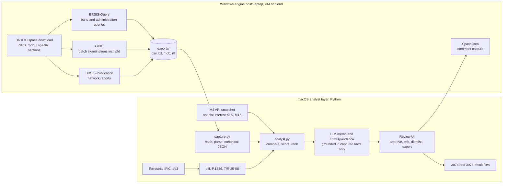

# Solution 04: ITU Toolchain Automation (official BR software as the engine, AI as the analyst layer)

> [!NOTE]
> Thesis: let the Bureau's own software do the examination, and let the AI do the analyst's paperwork. Every number that decides whether a filing matters (which networks sit in a band, which administrations the Bureau lists as affected, what pfd a network produces over Finland) comes from the ITU BR software that ships with the BR IFIC and that Traficom already runs, driven as batch jobs on one Windows host. Python on the team's Macs captures the tool outputs, cross-compares them with the Finnish table of frequencies and the special-interest stations, ranks them, and a language model writes the cited memo and the correspondence draft. The single bet: the credibility of "these are the regulator's own numbers", plus production realism for a partner who already owns the tools, outweighs the cost of driving Windows applications at a hackathon. A documented Python-lite fallback makes the bet safe: if a tool cannot be driven by Friday 23:00, its number is computed in Python and labelled as such.

## 1. Summary

What it is: a two-layer system. The engine layer is a Windows host running the ITU BR space software that comes with the BR IFIC: BRSIS-Query (formerly SpaceQry) for database queries, GIBC for batch examinations including pfd, BRSIS-Publication for network reports, and SpaceCom for the comment file on special sections `[FACTS: https://www.itu.int/en/ITU-R/software/Pages/space-network-software.aspx]`. The analyst layer is Python on macOS: it captures every file the engine produces, hashes it, parses it into a canonical finding schema, cross-compares it with Regulation M4 (via the Traficom open data API), the special-interest XLS and M15, ranks it with the existing `scoring` package, and asks a language model to write the summary, the explanation and the correspondence draft using only captured facts.

Who uses it: a Traficom spectrum specialist who already opens the IFIC in these tools every fortnight `[HYPOTHESIS]`. The workflow changes from "open each tool, query by hand, write the memo" to "run the batch, review a ranked queue, edit the drafted memo, press Export".

What it outputs: per IFIC issue, a ranked findings table, an evidence folder with the raw tool outputs, a memo per concern with citations to the notice, the tool output and the regulation, a correspondence draft addressed to the counterparty administration, and, where SpaceCom permits, the comment text ready to paste or import `[GAP - ASK PARTNER]`. For the mandatory deliverables, `out/space_3074/` and `out/terrestrial_3076/` are produced in the same format `[BRIEF]`.

Why it scores well: criterion A (technical analysis, 25 %) because the calculations come from the Bureau's examination software with all parameters visible in its output files; criterion E (auditability, 15 %) because every finding links to a hashed raw output and a notice id; criterion D (accuracy, 15 %) because the identification of candidate networks follows the same queries the experts run. Criterion B (extensibility, 25 %) is honest rather than flashy: the terrestrial IFIC is a SQLite database `[FACTS: https://www.itu.int/ITU-R/terrasys/docs/db/structure]`, so the analyst layer reads it directly and the engine layer is replaced by Python P.1546 and T/R 25-08 code; the same capture, scoring, memo and review components are reused unchanged.

## 2. Requirements map

| Brief workflow step `[BRIEF]` | Component or mechanism | Status | Notes |
|---|---|---|---|
| Ingest national info (M4 API, special-interest XLS, M15) | `analyst/national.py`: OData snapshot of the Finnish table (5917 rows, `$top`/`$skip` paging; capital letters in `Services_in_Finland` = primary) `[FACTS: https://opendata.traficom.fi/api/v13/Taajuusjakotaulukko]`; XLS via openpyxl; M15 PDF text index | core | Snapshot committed as JSON with date so runs are reproducible |
| Detect and retrieve new IFICs (monitoring) | `watch_ific.py`: polls the BR IFIC space page and the download page for a new issue number, downloads, records SHA-256, triggers the batch `[HYPOTHESIS: download may need a TIES account]` | core (light) | Fortnightly cadence `[BRIEF]`; cron or GitHub Actions schedule |
| Ingest Space IFIC (API/A, CR/C, AP30/30A/30B) | SRS-format MDB loaded on the Windows host (tables `notice`, `grp`, `freq`, `s_beam`, `emiss`, `geo`, `orbit`, `non_geo`, `srv_area`, `srv_cls`, `provn`, `pub_ssn`) `[FACTS: https://www.itu.int/en/ITU-R/software/Documents/spaceqry/srs_dbv6.pdf]`; special-section PDFs indexed by section id | core | `pub_ssn` is expected to carry the special-section reference per notice `[HYPOTHESIS]` |
| Identify interesting satellite systems | BRSIS-Query band and administration queries exported to files; GIBC coordination outputs; Python filter against Finnish bands | core | The "SpaceCom or direct database logic" option in the brief is taken as "the ITU tools, then direct logic on their exports" |
| pfd calculation (GSO and NGSO) | GIBC pfd examination for GSO networks `[HYPOTHESIS: module and output format]`; ITU PFD and EPFD packages exist on the software page `[FACTS: same URL]`; NGSO worst case in Python-lite | core (GSO), stretch (NGSO via tool) | Engine name recorded on every value |
| Summarise relevant content and frequency ranges | LLM summary over the captured query exports and special-section text | core | Structured output, cites capture ids |
| Cross-compare with M4, M15 and special-interest table | `analyst/compare.py`: band overlap, service match, station proximity | core | Same code for space and terrestrial |
| Identify items concerning Finland | `scoring.rank_groups` from the scoring package: score = 100 x relevance x (0.65 severity + 0.35 urgency), priority A >= 70, B >= 45, C >= 20 `[FACTS: branch claude/folder-scoring-system-a430c2, scoring/DESIGN.md]` | core | Severity factor fed by engine pfd margin |
| Explain concerns with calculations | Memo generator: engine value, limit, margin, parameters, with citations | core | Python-lite values labelled "indicative" |
| Identify counterparty administration | `notice` administration symbol, plus affected-administration lists from CR/C sections where present `[HYPOTHESIS: field names]` | core | Intergovernmental filings show the responsible administration `[HYPOTHESIS]` |
| Draft correspondence template | LLM fills a fixed letter template; SpaceCom comment text for API/A and CR/C | core (letter), stretch (SpaceCom file) | SpaceCom covers CR/C, API/A, AP30-30A Part A, AP30-30A/F/C, AP30B ESIM, Part I-S under 11.28.1 `[FACTS: software page]` |
| Space IFIC 3074 result file | `out/space_3074/findings.csv` + `memo.md` + `evidence/` | core | IFIC 3074 published 2026-06-23 `[FACTS: memory of ITU listing]`; 4-month comment windows `[FACTS]` |
| Terrestrial: diff consecutive IFICs (new, modified, withdrawn) | SQLite diff of `fxm_*` tables between `BRIFIC_nnnn.db3` files | core | ITU terrestrial tools optional, see section 9 |
| Filter foreign land-mobile assignments relevant to Finland | Band filter (29.7 to 470 MHz T/R 25-08 range), distance to Finnish border, neighbour administrations | core | Neighbours: Sweden, Norway, Estonia, Russia `[HYPOTHESIS: symbols S, NOR, EST, RUS]` |
| Determine ITU, CEPT and national framework | Rules table keyed by band: RR Article 5 allocation, T/R 25-08, M4 row | core | Table is data, not code |
| Identify criterion (ECC T/R 25-08) | Annex 1 triggers 0/6/12/18/20 dBuV/m per 25 kHz at 10 m, 10 % time, for 29.7-47, 47-108, 108-380, 380-400, 400-470 MHz, plus 10log10(channel/25 kHz) `[FACTS: https://docdb.cept.org/download/4789]` | core | |
| P.1546 field strength | Python port of the ITU-R SG3 reference implementation `[HYPOTHESIS: Py1546 by eeveetza on GitHub]`, validated with the ITU test vectors | core | No ITU batch tool is used here |
| Expert-reviewable findings with parameters and citations | Same `Finding` schema as space | core | |
| Terrestrial IFIC 3076 result file | `out/terrestrial_3076/findings.csv` + `memo.md` | core | |
| Trends and anomalies in neighbours' notices | SQL aggregates across issues: counts by administration, band, station class, bandwidth, border distance | stretch (small) | Three charts, no modelling |

## 3. Architecture



Deterministic code: everything from the IFIC download to the ranked table. The engine tools are deterministic by construction (same database, same query, same output). The capture step is deterministic (hash of each output file, parser with unit tests). The comparison, scoring and terrestrial calculations are plain Python with pinned versions and a committed configuration (`weights.json`, the M4 snapshot date, the P.1546 parameters).

The LLM does three things and nothing else: (1) summarise a captured export or special-section text into the fixed `Summary` structure; (2) write the explanation paragraph of a memo from a filled `Finding` (it may only reference capture ids and regulation clauses already present in the finding); (3) fill the correspondence template. It never produces a number that is not already in the finding, and the review UI shows the finding's numbers beside the prose so a mismatch is visible.

Two deliberate boundaries:

- The engine host never sees the LLM, and the analyst layer never recomputes what the engine computed. If the engine computed a pfd, the analyst layer uses it and records `engine = "GIBC"`. If the engine could not, the analyst layer computes the lite value and records `engine = "python-lite"`. Both values are never mixed in one finding without both labels.
- The human operator is part of the engine layer on day one. Where a tool has no command line, the operator runs it from a written checklist and the capture step verifies that the expected output files appeared with the expected columns. UI automation (pywinauto) is a Saturday stretch, not a Friday dependency.

## 4. Data ingestion

Space IFIC. The BR IFIC (space services) is distributed as a download that contains the SRS-format database and the BR software packages `[FACTS: the software page refers users to "the latest BR IFIC (space services) DVD-ROM" for software versions]`. The database tables used are `notice` (one row per notice: network name, administration, notification reason, dates), `grp` (frequency groups per beam with emission and power parameters), `freq` (assigned frequencies), `s_beam` (beams), `emiss` (emission designators and densities), `geo` and `orbit` (GSO longitude, NGSO orbital planes), `non_geo`, `srv_area` (service areas), `srv_cls` (classes of station and services), `provn` (regulatory provision), `pub_ssn` (special-section publication reference) `[FACTS: https://www.itu.int/en/ITU-R/software/Documents/spaceqry/srs_dbv6.pdf]`. Column names beyond the table level are confirmed against that PDF on Friday night; until then every column name in this plan is `[HYPOTHESIS]`.

Three ways to read the database, in order of preference:

1. On the Windows host, through the ITU tools themselves: BRSIS-Query runs the band and administration queries and exports the result set `[HYPOTHESIS: export formats include Excel, CSV or MDB]`. This is the route that makes the "regulator's own numbers" claim true for the selection step.
2. On the Windows host, through `pyodbc` with the Microsoft Access ODBC driver, for ad hoc SQL when a query cannot be expressed in the tool `[HYPOTHESIS: driver present with Office or the Access Database Engine redistributable]`.
3. On macOS, through `mdbtools` (`mdb-tables`, `mdb-export`) to CSV `[HYPOTHESIS: mdbtools reads Access 2000 to 2016 formats; large tables export slowly]`. This is the fallback that keeps the analyst layer working if the Windows host is down.

Special sections. API/A, CR/C and AP30/30A/30B special sections are published with the IFIC as PDF `[BRIEF]`. The ingestion step splits each PDF by special-section reference, extracts text with `pypdf`, and stores it next to the notice id so the LLM summary step and the memo citations can quote the page `[HYPOTHESIS: the affected-administration lists in CR/C sections are also in the database; where they are not, the PDF text is the source]`.

Terrestrial IFIC. Since IFIC 3042 (2025-03-18) the terrestrial IFIC is a SQLite file, `BRIFIC_nnnn.db3` in the TerRaBase structure, with the FXM domain tables `fxm_terra`, `fxm_ant`, `fxm_tx`, `fxm_rx`, `fxm_geo`; land-mobile notices use the T12 item keys such as `t_freq_assgn`, `t_lat` (format +DDMMSS), `t_pwr_dbw`, `t_pwr_eiv`, `t_hgt_agl`, `t_azm_max_e` `[FACTS: https://www.itu.int/ITU-R/terrasys/docs/db/structure]`. Python's `sqlite3` reads it directly on any platform. No Windows tool is needed for the side quest, which is why section 9 can promise the full side quest even if the engine host fails.

Regulation M4 and the Finnish table. The table of frequencies is fetched from the OData endpoint with `$top`/`$skip` paging and stored as `data/reference/taajuusjakotaulukko_<date>.json.gz`; a snapshot from 2026-11-06 already exists on the scoring branch `[FACTS: scoring/reference/taajuusjakotaulukko_2026-11-06.json.gz]`. Primary services are the capitalised entries in `Services_in_Finland` `[FACTS]`. The regulation text itself (finlex) is indexed as PDF text for footnote citations `[BRIEF: https://www.finlex.fi/fi/viranomaiset/maarayskokoelmat/traficom-viestinta/2026/3]`.

Special-interest XLS. Loaded with `openpyxl` into a `ProtectedStation` table: station number, centre frequency and bandwidth, coordinates, antenna height, direction, directivity `[BRIEF]`. Column names are mapped in one YAML file so the real sheet, once seen on the platform, changes one file `[GAP - ASK PARTNER: exact columns and units]`.

M15, CEPT and RR. M15 is indexed as text for citations only `[BRIEF: less relevant]`. The CEPT implementation overview is used by hand for the framework table in section 9 `[BRIEF: https://docdb.cept.org/implementation/overview]`. RR Article 21 Table 21-4 limits live in `scoring/reference/rr_article21_table21-4.json`, whose rows are still marked `verified: false` and must be checked against the RR edition in force on Friday night `[FACTS: scoring/DESIGN.md section 6]`.

Fallbacks if a source cannot be parsed in time: the MDB export route 3 replaces routes 1 and 2; the special-section PDF text replaces missing database columns; a hand-built CSV of the ten highest-priority 3074 networks, typed from BRSIS-Publication reports, replaces a failed parser for the demo and is labelled `source = "manual transcription"`.

## 5. Relevance detection for Finland (space)

Candidate selection runs in the engine, filtering runs in the analyst layer.

Engine queries (BRSIS-Query, one per IFIC):

- Q1: all notices published in the IFIC issue, with notification reason and special-section reference, exported with the `notice` and `pub_ssn` columns `[HYPOTHESIS: the issue number is a filter field]`.
- Q2: frequency groups of those notices whose assigned band overlaps any Finnish band of interest. The band list is generated by the analyst layer from M4 (all bands where Finland has a primary terrestrial or space service) and from the special-interest XLS (centre frequency plus or minus half bandwidth, widened by a configurable guard band, default 10 %) and pasted into the query `[HYPOTHESIS: BRSIS-Query accepts a frequency range filter]`.
- Q3: for CR/C notices, the list of affected administrations, to check whether FIN appears `[HYPOTHESIS: location of the list]`.

Analyst filter, in order, each step recording its evidence:

1. Frequency overlap: group band `[f_min, f_max]` from `grp` intersects a Finnish band; overlap fraction and the M4 row id are recorded. Adjacent-band cases within the guard band are kept with a lower factor, because the brief names "the same or adjacent frequency range" `[BRIEF]`.
2. Direction: space-to-Earth emissions can interfere with Finnish terrestrial receivers and Finnish earth stations; Earth-to-space emissions matter for Finnish satellite receivers and for earth stations near the filed earth stations. The `emi_rcp` style flag in `grp` decides which Finnish services are compared `[HYPOTHESIS: column name]`.
3. Geography: for GSO, the elevation angle from Finland to the nominal longitude (computed at six reference points: Helsinki, Turku, Vaasa, Oulu, Rovaniemi, Utsjoki); networks below 3 degrees elevation at all points are set to geography factor 0.1 rather than 0, because low-elevation pfd limits are the strictest and the experts may still care `[HYPOTHESIS: threshold]`. For NGSO, inclination greater than or equal to 60 degrees covers Finland fully; lower inclinations use the maximum latitude reached by the orbit versus Finland's 59.8 to 70.1 degrees N. Service areas from `srv_area` and GIMS contours, when GIBC outputs include them, override the geometric estimate `[HYPOTHESIS]`.
4. Service match: the class of station and service in `srv_cls` is compared with the M4 service in the overlapping row; a co-primary allocation in Finland with a different service is the classic concern `[HYPOTHESIS]`.
5. Finnish networks: any Finnish satellite network in the SRS (administration FIN) with overlapping bands marks the notice as a satellite-to-satellite concern, which the brief singles out `[BRIEF]`; the list of Finnish networks is itself an engine query (Q4: administration = FIN) and is shown to the specialists on Saturday for confirmation `[GAP - ASK PARTNER]`.
6. Stage and urgency: API/A, CR/C and AP30 special sections carry 4-month comment windows `[FACTS]`; days remaining feed the urgency factor.

Ranking: `scoring.rank_groups` combines these into relevance = frequency overlap x geography x direction (multiplicative gates), severity from the pfd margin in section 6, urgency from the deadline, and assigns priority A, B or C `[FACTS: scoring/DESIGN.md]`. The weights file is the only place numbers change, and its version is written into every result file.

## 6. Technical calculations

pfd, engine path. GIBC is "a software package which provides the user with the ability to carry out calculations on satellite networks which allow determining the coordination requirements" `[FACTS: software page]`. The ITU software page also lists separate PFD and EPFD packages `[FACTS: same page, navigation list]`. The working assumption is that GIBC or the PFD package can examine a GSO network's pfd against the Article 21 limits for a selected test point or administration and write a results file `[HYPOTHESIS; verified Friday night, see section 13]`. The capture parser stores, per network and group: test point, elevation angle, reference bandwidth, computed pfd in dB(W/m2), the applicable limit, margin, and the tool version string. The margin is the severity input.

pfd, Python-lite path (used when the engine path is unavailable, or to cross-check it; always labelled "indicative"):

- Inputs from `grp` and `emiss`: maximum power density toward the test point `P_d` in dB(W/Hz) `[HYPOTHESIS: column]`, antenna gain toward the point taken as the peak gain `G` in dBi unless a contour from GIMS data gives a lower value, and the reference bandwidth `B_ref` in Hz from the Table 21-4 row (4 kHz or 1 MHz depending on the band) `[HYPOTHESIS: table rows not yet verified]`.
- Slant range for GSO from a point at latitude `phi` and longitude difference `dlambda` to the nominal longitude: `cos(gamma) = cos(phi) * cos(dlambda)`; `d = sqrt(R_e^2 + r_gso^2 - 2 * R_e * r_gso * cos(gamma))` with `R_e = 6378.137 km` and `r_gso = 42164.2 km`; elevation `eps = atan((cos(gamma) - R_e / r_gso) / sqrt(1 - cos(gamma)^2))`.
- pfd in dB(W/m2) per `B_ref`: `pfd = P_d + G + 10 * log10(B_ref) - 10 * log10(4 * pi * d^2)` with `d` in metres.
- Limit: Table 21-4 value for the band and the elevation class (0 to 5, 5 to 25, 25 to 90 degrees); the 5 to 25 class is linear in elevation in the RR, implemented as such `[HYPOTHESIS until the table is verified]`. Margin = pfd minus limit; positive means exceedance.
- NGSO worst case: `d = h_min` (nadir pass at the lowest filed altitude), elevation 90 degrees, so `pfd_max = P_d + G + 10 * log10(B_ref) - 10 * log10(4 * pi * h_min^2)`. This is an upper bound and is shown as "worst-case bound, not an epfd examination"; a real epfd check under Article 22 is out of scope and is said so in the memo `[HYPOTHESIS]`.

P.1546 for terrestrial. Inputs: frequency in MHz (valid 30 to 4000 MHz), distance in km along the path from the station to the Finnish test point, effective transmitting antenna height in metres (from `t_hgt_agl` plus terrain, terrain taken as flat in the lite version), time percentage 10 % as required by T/R 25-08 Annex 1, location percentage 50 %, path type land, sea or mixed (sea for Estonia across the Gulf of Finland, mixed for the Gulf of Bothnia, land for Norway and Russia), receiving antenna height 10 m `[FACTS for the 10 m and 10 % values: https://docdb.cept.org/download/4789; HYPOTHESIS for the rest]`. Output: field strength `E_1kW` in dB(uV/m) for 1 kW e.r.p.; the notified station's field strength is `E = E_1kW + (P_erp_dBW - 30)` where `P_erp_dBW` is derived from `t_pwr_dbw` and the antenna gain in the direction of the test point from `fxm_ant` `[HYPOTHESIS: the T12 keys carry e.r.p. or e.i.r.p.; `t_pwr_eiv` indicates which]`. The implementation is the Python port of the ITU-R SG3 reference code, validated against the ITU validation examples before use `[HYPOTHESIS: Py1546 on GitHub by eeveetza]`; if the port cannot be validated by Saturday noon, the fallback is the P.1546 land-path curves digitised for 100 MHz, 600 MHz and 2000 MHz with interpolation, labelled "curve approximation".

T/R 25-08 criterion. The trigger field strength at the border, or at the test point, is `E_trig = base + 10 * log10(channel_kHz / 25)` with base 0, 6, 12, 18 or 20 dB(uV/m) per 25 kHz for the ranges 29.7 to 47, 47 to 108, 108 to 380, 380 to 400 and 400 to 470 MHz, at 10 m height and 10 % time `[FACTS: https://docdb.cept.org/download/4789]`. A finding is raised when `E` at any Finnish test point within 100 km of the station exceeds `E_trig`; the margin is the severity input `[HYPOTHESIS: test-point spacing 5 km along the border]`.

Labelling and reproducibility. Every numeric field carries `engine` (`GIBC`, `PFD-tool`, `python-lite`, `P1546-port`, `curve-approx`, `manual`), `engine_version`, `config_version` and the SHA-256 of the raw output file or of the input row. A `run.json` records the IFIC issue number, the M4 snapshot date, the weights version, the Python package versions and the host on which the engine ran. Unit tests cover the slant-range geometry (Helsinki to 0 degrees E and to 100 degrees E), the pfd formula against a hand-computed case, the P.1546 port against the ITU validation examples, and the T/R 25-08 trigger table.

## 7. AI components and guardrails

Model: Claude `claude-sonnet-5-5` through the Anthropic SDK with structured outputs; `claude-opus-5-5` only for the memo of priority-A findings if time allows. Temperature 0, prompts committed in `prompts/`, every call logged with input hash and output `[HYPOTHESIS: cloud use allowed for public IFIC data; if the partner objects, a local open-weight model behind the same interface]`.

Used for: special-section and query-export summaries into a fixed schema (network, administration, bands, stage, deadline, affected administrations named in the text); the explanation paragraph of each memo; the correspondence draft; and an optional "ask about this finding" box in the review UI.

Forbidden: computing or restating any number that is not in the `Finding` object; deciding priority; choosing the counterparty; writing to SpaceCom; sending anything. The structured output schema has no free numeric fields: numbers are copied by code into the prose template after generation, and a post-check rejects any generated sentence that contains a number not present in the finding.

Grounding: the prompt contains only the finding, its evidence excerpts and the regulation clauses it cites; the model must reference evidence by id. A validator checks that every cited id exists, that no uncited claims about limits appear, and that unknown fields are rendered as "not stated in the notice" rather than guessed.

On uncertainty: if a special section's text and the database disagree, the finding is marked `conflict = true`, both values are shown, and the memo says which one the engine used. If the engine produced no pfd and the lite path lacks a power density, the finding is kept with `severity = unknown` and a note; it never silently drops.

## 8. Auditability and evidence model

```text
Finding
  id, ific_issue, notice_id (SRS ntc_id), network_name, administration, special_section_ref
  concern_type: pfd_exceedance | band_overlap_primary | finnish_network_overlap | adjacent_band | terrestrial_field_strength
  values: {name, value, unit, engine, engine_version, limit, margin, config_version}
  score, priority, urgency_days
  counterparty_adm, counterparty_basis
  evidence: [Evidence]
Evidence
  id, kind: engine_output | database_row | special_section_text | regulation | national_table | protected_station | calculation
  source_ref: file path + sha256 + locator (row key, page, clause, M4 row id)
  excerpt
```

Citation format in memos: `[E12: GIBC pfd results, sha256 ab12..., row ntc_id=123456789 grp_id=3]`, `[E13: RR Art. 21 Table 21-4, 3400-4200 MHz, 0-5 deg]`, `[E14: M4 table row 2271, 3400-3800 MHz, MOBILE primary]`, `[E15: CR/C/1234 page 3]`. The review UI opens the raw output file at the row.

Trace: `run.json` plus `trace.jsonl` with one line per step (query issued, file captured, parser version, scoring input and output, LLM call hash). An expert verifies a conclusion by opening the engine output named in the evidence, re-running the same query in BRSIS-Query from the written query definition, and comparing the margin against the limit row cited. The raw output folder is part of the submission for 3074 and 3076, so the evaluators can do the same `[BRIEF: information on input and output]`.

## 9. Terrestrial side quest

Reused unchanged: `capture.py` (hashing and canonical parsing), `compare.py` (band overlap, service match, protected-station proximity), the scoring package through `rank_notices`, the memo and correspondence generator, the review UI and the result-file writer.

Replaced: the engine layer. The terrestrial IFIC is SQLite, so Python reads `BRIFIC_3075.db3` and `BRIFIC_3076.db3` directly `[FACTS: https://www.itu.int/ITU-R/terrasys/docs/db/structure]`. The ITU terrestrial tools (TerRaQ for queries, TerRaNotices for notice preparation, TerRaNV for validation) are believed to exist as Windows applications `[HYPOTHESIS]`; they are used only if a specialist at the Saturday 11-12 slot says the experts rely on a specific TerRaQ report, in which case that report is captured like a GIBC output.

Added, following the brief's bullets `[BRIEF]`:

1. Diff of consecutive issues: rows keyed by notice id and fragment across `fxm_terra`, `fxm_tx`, `fxm_rx`, `fxm_ant`, `fxm_geo`; a row present only in 3076 is new, present in both with changed values is modified (changed columns listed), present only in 3075 is withdrawn `[HYPOTHESIS: the database may also carry an explicit action code, which takes precedence if present]`.
2. Filter: land-mobile notices (T12 item keys) `[FACTS]` from administrations other than FIN whose station lies within 150 km of the Finnish border or coast, in the 29.7 to 470 MHz range covered by T/R 25-08, or in any band where the special-interest XLS has a station within 150 km `[HYPOTHESIS: distance]`.
3. Framework: a table keyed by band gives the RR Article 5 allocation, the CEPT instrument (T/R 25-08 for land mobile in 29.7 to 470 MHz, otherwise "no CEPT coordination recommendation identified, bilateral agreement to be checked"), and the M4 row; bilateral agreements between Finland and Sweden, Norway, Estonia and Russia are `[GAP - ASK PARTNER]`.
4. Criterion: T/R 25-08 Annex 1 triggers as in section 6 `[FACTS]`.
5. Calculation: P.1546 field strength from the notified station (coordinates from `t_lat` and the longitude key, height from `t_hgt_agl`, power from `t_pwr_dbw` with `t_pwr_eiv`, azimuth from `t_azm_max_e`) `[FACTS: keys; HYPOTHESIS: units and sign conventions]` at Finnish test points every 5 km along the border and coast, plus at each special-interest station within 150 km with the station's antenna height and direction applied as a receiving-side note (no receiver pattern is modelled in the first version, and the memo says so).
6. Findings: the same schema, with `values = {E, E_trig, margin, f, d, h_eff, t, path_type, model_version}` and citations to the notice row, the T/R 25-08 clause and the M4 row.

Trends and anomalies: a small SQL layer over all ingested issues counts notices per administration, band, station class and bandwidth, and flags a band or administration whose count in the latest issue exceeds the mean of the previous six issues by two standard deviations, plus new activity within 50 km of the border in a band with Finnish primary use `[HYPOTHESIS: thresholds]`. Three charts in the UI; the memo lists the top three anomalies with the counts behind them.

## 10. Outputs and deliverables

Findings file (`findings.csv`, one row per finding; `findings.json` with the full objects): `finding_id, ific_issue, notice_id, network_or_station, administration, special_section_or_notice_type, orbit_or_location, freq_min_mhz, freq_max_mhz, direction, fin_m4_row, fin_service, fin_primary, special_interest_station_ids, geography_factor, concern_type, value_name, value, unit, engine, limit, margin_db, score, priority, urgency_days, counterparty_adm, evidence_ids, reviewer_decision, reviewer_note`.

Memo (`memo.md`): one section per priority-A and B finding: what the notice is, why it concerns Finland, the calculation with parameters and engine, the regulatory basis, the recommended action, and the evidence list. Priority-C findings are a table.

Correspondence draft (`correspondence/<adm>_<notice_id>.md`): a fixed template with addressee (the counterparty administration, from the notice's administration symbol or, for intergovernmental filings, the responsible administration `[HYPOTHESIS]`), reference to the special section and IFIC number, the Finnish assignments or allocations concerned with M4 citations, the technical parameters and computed margin with engine label, the request (inclusion in coordination, technical data, or acknowledgement of protection rights) and the comment deadline. For API/A and CR/C the same content is condensed into comment text for SpaceCom; whether SpaceCom can import it or the operator pastes it is `[GAP - ASK PARTNER]`.

Mandatory result files `[BRIEF]`: `out/space_3074/` and `out/terrestrial_3076/`, each containing `findings.csv`, `findings.json`, `memo.md`, `correspondence/`, `evidence/` (raw engine outputs with hashes, or the SQLite diff tables), `run.json` and `README.md` describing inputs and the exact commands. These are copied unchanged into the submission.

Repository layout:

```text
engine/        windows/ (install notes, query definitions, GIBC checklists, pywinauto scripts), capture.py, parsers/
analyst/       national.py, compare.py, geometry.py, pfd_lite.py, p1546/, tr2508.py, memo.py, correspondence.py
scoring/       (merged from the scoring branch)
ui/            streamlit_app.py
data/          reference/ (M4 snapshot, Table 21-4 JSON, T/R 25-08 triggers), partner/ (git-ignored), cache/
out/           space_3074/, terrestrial_3076/
tests/
```

## 11. Human-in-the-loop UI

A Streamlit app with three screens, using the repo's design tokens where Streamlit allows and otherwise plain `[README: design/girlypop-theme.md; no playful copy on findings]`:

1. Queue: ranked findings for the selected IFIC, filters by priority, concern type and administration, days-to-deadline column, engine label column.
2. Finding: the numbers on the left (value, limit, margin, parameters, engine, config version), the memo paragraph on the right, the evidence list with "open raw output" links, buttons Approve, Investigate, Dismiss, each requiring a reviewer name and storing a note; the correspondence draft below with an editable text area.
3. Export: writes the result folder and the audit log (`decisions.jsonl`: who, what, when, finding id, previous state).

Nothing leaves the machine from the UI; the operator takes the approved comment text to SpaceCom by hand on day one.

## 12. Tech stack

- Engine host: Windows 11 (the ITU packages support Windows 10 and 11 only `[FACTS: software page]`). Preference order: a team member's Windows laptop; a Windows 11 VM in Parallels or UTM on an Apple Silicon Mac (x86 applications run under emulation, which is untested for these packages `[HYPOTHESIS]`); a cloud Windows VM (Azure or AWS, ordered Friday evening as insurance, about 1 EUR per hour `[HYPOTHESIS]`).
- Engine automation: written checklists first; PowerShell for file moves; `pywinauto` for GUI automation as a stretch `[HYPOTHESIS: the tools are classic Win32 or .NET applications]`.
- Analyst layer: Python 3.12, pandas, `sqlite3`, `pyodbc` on Windows, `mdbtools` on macOS, `openpyxl`, `pypdf`, `requests`, `shapely` and `pyproj` for distances and the border polyline (Natural Earth 10 m boundaries `[HYPOTHESIS]`), the P.1546 port, the `scoring` package, `pytest`.
- LLM: Anthropic SDK, `claude-sonnet-5-5`, structured outputs, temperature 0.
- UI: Streamlit. Reason: one Python process, no frontend build, and the demo is about numbers and evidence rather than visual polish.
- Reproducibility: `uv` lockfile, `run.json`, committed reference data with dates.

## 13. Build plan: Fri 19:30 to Sun 10:00

| Sprint | Time | Owner | Work | Gate |
|---|---|---|---|---|
| S1 | Fri 19:30-21:00 | BE + PM | Download the IFIC that contains 3074 (or the latest) from the ITU download page; confirm which software packages ship with it and their versions; bring up the Windows host (laptop first, VM second, cloud third, all three started in parallel); install BRSIS-Query, GIBC, BRSIS-Publication, SpaceCom | Engine host boots, database opens in BRSIS-Query |
| S1 | Fri 19:30-21:00 | AI | M4 snapshot and special-interest XLS loader; `Finding` and `Evidence` schemas; merge the scoring package | `pytest` green on schemas and scoring |
| S1 | Fri 21:00-23:00 | BE | Run Q1 to Q4 in BRSIS-Query on the 3074 database; export; write the capture parser; run one GIBC pfd examination on one GSO network and capture the output | **Gate 1, Fri 23:00**: if Q1 to Q3 export and parse, the engine route is alive. If GIBC pfd does not produce a parseable file, pfd goes to Python-lite for the night and the GIBC attempt is retried after the Saturday 10-11 slot. If the host itself fails, the whole engine layer becomes `mdbtools` plus Python-lite and this plan converges on Solution 01 with an "ITU tool cross-check" section |
| S2 | Fri 23:00-Sat 03:00 | AI + FE | `compare.py`, geometry, pfd-lite, memo generator, first Streamlit queue on 3074 exports | Ranked 3074 list exists, ugly |
| Sleep | Sat 03:00-07:30 | 2 sleep, 2 continue on terrestrial ingestion (SQLite diff of 3075 vs 3076) | | |
| S3 | Sat 07:30-10:00 | all | Prepare the 3074 top-10 list and the question sheet for the specialists | |
| Q&A | Sat 10:00-11:00 | PM + BE | Space specialists: which GIBC or PFD module and settings they use for pfd and AP30 checks; where the affected-administration list sits; how they decide a filing concerns Finland; the list of Finnish networks; what they expect in the 3074 result file; whether SpaceCom can import comment text `[GAP - ASK PARTNER]` | Answers written into 00_shared_facts.md |
| Q&A | Sat 11:00-12:00 | AI | Terrestrial specialists: which notice fields and units; how they apply T/R 25-08 and P.1546 (heights, time percentage, test points); bilateral agreements with S, NOR, EST, RUS; what 3076 findings they would expect | Same |
| S4 | Sat 12:00-16:00 | BE + AI | Apply the answers: GIBC settings, affected lists, P.1546 port validated against the ITU examples, T/R 25-08 findings for 3076, correspondence template, LLM memo with validator | **Gate 2, Sat 16:00**: 3074 and 3076 result folders exist end to end with engine labels |
| Q&A | Sat 16:00-17:00 | AI | Terrestrial specialists: review five 3076 findings and the trends charts | Corrections applied |
| Q&A | Sat 17:00-18:00 | PM + BE | Space specialists: review five 3074 findings and one correspondence draft; confirm the engine labels read correctly | Corrections applied |
| S5 | Sat 18:00-22:00 | all | Review UI decisions and audit log; pywinauto for the BRSIS-Query export if time allows; tests; README with exact commands | **Gate 3, Sat 22:00**: feature freeze |
| S6 | Sat 22:00-Sun 02:00 | FE + PM | Demo Mode cache of both result folders; video script; deck | **Gate 4, Sun 02:00**: demo runs from cache without the Windows host |
| Sleep | Sun 02:00-06:00 | | | |
| S7 | Sun 06:00-09:15 | all | Record the video; export the deck; final check of the submission folder (code, result files, input and output documentation) | FINAL at 09:15, hard deadline 10:00 `[README: pm_pack/05]` |

Kill and pivot rules: no more than six person-hours in total on GUI automation; if the Windows host is unavailable for more than two hours at any point after Gate 1, the engine layer is frozen at whatever outputs were captured and the rest is Python-lite; the terrestrial side quest never waits for the engine host.

## 14. Risks and fallbacks

| Risk | L (1-5) | I (1-5) | Trigger | Fallback |
|---|---|---|---|---|
| IFIC download requires a TIES account or is too large for the venue network `[HYPOTHESIS]` | 3 | 5 | No database file by Fri 21:00 | Ask the partner on Discord for the 3074 and 3076 files; meanwhile build on the SRS structure document and a hand-made sample database |
| ITU packages do not run in the VM (ARM emulation, missing runtimes) `[HYPOTHESIS]` | 3 | 4 | Installer or app fails by Fri 22:00 | Cloud Windows VM; if that fails too, `mdbtools` plus Python-lite for everything, tools used only for the screenshots of a cross-check |
| GIBC pfd output format undocumented or not parseable | 3 | 3 | Parser cannot read it by Fri 23:00 | Operator reads the values into a CSV for the top networks (`engine = manual`); Python-lite for the rest; ask at the 10-11 slot |
| Table 21-4 rows unverified | 4 | 3 | Rows still `verified: false` at Gate 2 | Verify from the RR text on Friday night; until then every limit shown with "unverified table row" |
| Column names in the SRS tables differ from assumptions | 4 | 2 | Parser errors | The SRS structure PDF is the reference; column map in one YAML file |
| P.1546 port not validated | 2 | 3 | Validation examples fail by Sat 12:00 | Curve approximation, labelled |
| Reproducibility doubts because of manual GUI steps | 3 | 3 | Judge asks "can I re-run this?" | Written query definitions, hashed outputs, `run.json`; the terrestrial side is fully scripted and shows it |
| Cloud LLM not acceptable to the partner | 1 | 2 | Partner says so on Saturday | Local open-weight model behind the same client; IFIC data is public anyway |
| Scope creep into Solution 05-style maps | 3 | 2 | Someone starts a map at Sat 18:00 | Freeze; a single static map of GSO elevation per reference point is allowed |

## 15. Self-assessment against the evaluation criteria

| Criterion | Weight | Expected (0-10) | Reason |
|---|---|---|---|
| A. Technical analysis and reproducibility | 25 | 8 | Numbers from the Bureau's own examination software with parameters captured; deterministic analyst layer with hashes and `run.json`; one point lost for the manual GUI steps, one for the unverified NGSO bound |
| B. Extensibility and terrestrial side quest | 25 | 6 | The analyst, scoring, memo and review layers are reused as is, and the side quest is complete and fully scripted; but the engine layer is not reused, which is honest and visible |
| C. Workflow usefulness, innovation and output quality | 20 | 6 | Directly usable by people who already run these tools; the innovation is the capture-and-label discipline and the drafted correspondence rather than a new model |
| D. Case recognition accuracy and relevance | 15 | 7 | Candidate selection follows the experts' own queries and the Bureau's affected lists; guard-band and elevation thresholds still need the Saturday answers |
| E. Auditability and evidence quality | 15 | 8 | Every value carries engine, version, hash and locator; raw outputs ship with the result files |

Weighted total: (8 x 25 + 6 x 25 + 6 x 20 + 7 x 15 + 8 x 15) / 10 = 69.5 out of 100.

## 16. Demo script (2 minutes)

- 0:00-0:15. "Every fortnight the ITU publishes hundreds of satellite filings. Traficom's specialists already own the software that examines them. We put an analyst layer on top of it."
- 0:15-0:40. Screen: the Windows host with BRSIS-Query on IFIC 3074, the exported query, then the terminal on the Mac running `python -m analyst run --ific 3074`; the capture log shows files hashed and parsed, engine labels appear.
- 0:40-1:10. Screen: the queue for 3074; top finding opened: band overlap with a Finnish primary allocation, GIBC pfd value against the Table 21-4 limit, margin, parameters, the raw output file opened at the row, the M4 row cited.
- 1:10-1:30. The memo paragraph and the correspondence draft addressed to the notifying administration with the comment deadline; the reviewer edits one sentence, presses Approve; the audit log updates.
- 1:30-1:50. Switch to terrestrial: 3075 versus 3076 diff counts, a new land-mobile station across the border, P.1546 field strength at the nearest Finnish test point against the T/R 25-08 trigger, the finding with its parameters; the trends chart.
- 1:50-2:00. "Regulator's numbers, analyst's paperwork, expert's decision. Result files for 3074 and 3076 are in the repository."

## 17. What makes this different from the other four approaches

- Deterministic pipeline (Solution 01): re-implements the examination logic in Python and SQL as the main path; this plan treats Python as the fallback and the ITU tools as the main path, trading some scriptability for the regulator's own numbers.
- Agentic workflow (Solution 02): lets LLM agents plan which tools to call; this plan fixes the sequence of tool runs in a checklist and script, and uses the LLM only for text, which costs flexibility but removes orchestration from the audit trail.
- Knowledge graph (Solution 03): integrates all sources into one typed graph and derives findings from graph queries; this plan keeps the sources in their native tools and databases and integrates only the captured outputs.
- Geospatial interference twin (Solution 05): computes pfd and field strength on a grid over Finland as the primary model; this plan computes at a handful of reference points and relies on the Bureau's examination for pfd, with geography as a factor rather than the centre of the product.
