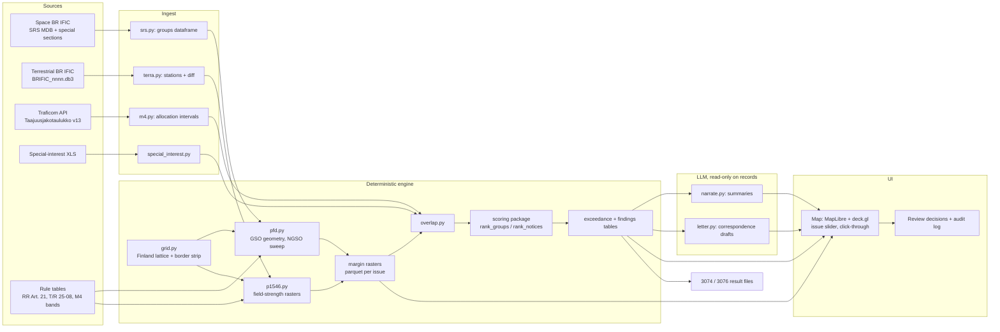

# Solution 05: Geospatial Interference Twin (map-first grid screening over Finland)

> [!NOTE]
> Thesis: treat the whole problem as geometry and power. Lay a fixed grid over Finland, and for every satellite beam in an IFIC compute, cell by cell, the elevation to the satellite and the resulting power flux-density (pfd) at the ground from the filed parameters; for every new foreign land-mobile station compute the ITU-R P.1546 field strength into Finnish border cells. Findings are exceedances of a limit at a place, ranked by margin and area. The single bet: an expert trusts a number they can see on a map with its formula next to it faster than any text summary, and the same raster engine serves space and terrestrial with only the propagation model swapped.

## 1. Summary

The Interference Twin is a screening engine plus a map. It ingests a Space BR IFIC (the SRS database and the special sections it carries) and a Terrestrial BR IFIC (the SQLite TerRaBase), the Finnish table of frequencies from the Traficom open data API, and the synthetic table of frequencies of special interest (XLS) `[BRIEF]`. It produces, per IFIC issue, three artefacts: a pfd margin raster per satellite beam over Finland, a field-strength raster per foreign land-mobile notice along the Finnish border, and exceedance tables that become the ranked findings, the draft correspondence, and the mandatory result files for Space IFIC 3074 and Terrestrial IFIC 3076 `[BRIEF]`.

Users are Traficom spectrum specialists. They open the map, move a slider across IFIC issues, click a red cell or a highlighted protected station, and see the finding card: which network, which group of frequencies, which Finnish allocation it overlaps, the computed pfd versus the applicable limit at that elevation, every input value with its source table and field, and a draft letter to the notifying administration. The LLM never computes anything; it narrates computed records and drafts correspondence from them.

Why it scores well: the computation is deterministic, vectorised and reproducible (criterion A), the same grid engine runs the terrestrial side quest with P.1546 instead of free-space spreading (B), the map with a time slider is immediately useful and unusual (C), geometry-first screening removes the most common false positives, namely satellites that cannot even see Finland at a meaningful elevation (D), and every cell value carries provenance (E).

## 2. Requirements map

| Brief workflow step | Component or mechanism | Status | Notes |
|---|---|---|---|
| Ingest national info: M4 API | `ingest/m4.py` pulls all rows of `https://opendata.traficom.fi/api/v13/Taajuusjakotaulukko` (OData, `$top`/`$skip` paging, 5917 rows; capitals in the Finnish services column mean primary) `[FACTS]` | core | Snapshot committed with date in the file name |
| Ingest special-interest XLS | `ingest/special_interest.py` with openpyxl: station number, centre frequency, bandwidth, coordinates, antenna height, direction, directivity `[BRIEF]` | core | Column semantics `[GAP - ASK PARTNER]` |
| Ingest M15 | Band list only, as a secondary overlay | stretch | Brief says less relevant `[BRIEF]` |
| Detect and retrieve new IFICs (monitoring) | `monitor/ific_watch.py`: poll the BR IFIC pages, compare issue numbers against `data/issues.json`, download and register `[HYPOTHESIS]` on page structure | core (poll) / stretch (auto-download) | Login or TIES requirements `[GAP - ASK PARTNER]` |
| Ingest Space IFIC (API/A, CR/C, AP30/30A/30B) | `ingest/srs.py` reads the SRS MDB tables `notice`, `grp`, `freq`, `s_beam`, `emiss`, `geo`, `orbit`, `non_geo`, `srv_area`, `srv_cls`, `provn`, `pub_ssn` `[FACTS]` (https://www.itu.int/en/ITU-R/software/Documents/spaceqry/srs_dbv6.pdf) via mdbtools | core | Special-section type comes from `pub_ssn` `[HYPOTHESIS]` |
| Identify interesting satellite systems | Grid pre-filter: GSO visible from any Finnish cell above a minimum elevation; NGSO inclination plus altitude reaches Finnish latitudes; frequency overlap with M4 rows or special-interest stations | core | Section 5 |
| pfd calculation (GSO and NGSO) | `engine/pfd.py`: per-cell slant range and elevation, pfd per reference bandwidth, NGSO elevation sweep | core | Section 6 |
| Summarise relevant content and frequency ranges | Finding card and per-network summary generated from the exceedance table by the LLM | core | Grounded only in computed fields |
| Cross-compare with M4/M15 and special-interest table | Interval overlap between `grp.freq_min`/`freq_max` `[HYPOTHESIS]` and M4 rows; point-in-cell join of stations | core | |
| Identify items concerning Finland | Exceedance per cell or station, ranked with the `scoring` package | core | Section 5 and 10 |
| Explain concerns with calculations | Finding card shows formula, inputs, limit row, margin | core | Section 8 |
| Identify counterparty administration | `notice.adm` `[HYPOTHESIS]` mapped to administration name via a committed lookup table | core | |
| Draft correspondence template | `draft/letter.py` fills a fixed template from the finding record; LLM writes the narrative paragraph only | core | Expert edits before anything leaves |
| Space IFIC 3074 result file | `outputs/space_ific_3074_findings.csv` plus `.md` memo | core | Section 10 |
| Terrestrial: diff consecutive IFICs | `ingest/terra.py` loads `BRIFIC_3075.db3` and `BRIFIC_3076.db3` `[FACTS]`, keyed station diff gives new, modified, withdrawn | core | Section 9 |
| Filter foreign land-mobile assignments relevant to Finland | Administration in neighbour set, distance to Finnish border below a radius, band overlap with M4 | core | |
| Determine ITU/CEPT/national framework | Rule table keyed by band: RR Article 5 allocation, ECC T/R 25-08 band row, M4 row | core | |
| Identify criterion (ECC T/R 25-08) | Annex 1 trigger values per band plus bandwidth correction `[FACTS]` | core | |
| P.1546 field-strength calculation | `engine/p1546.py` port of the ITU-R reference implementation, precomputed distance curves per station | core | Section 6 |
| Expert-reviewable findings with parameters and citations | Same finding card as space, with model parameters block | core | |
| Terrestrial IFIC 3076 result file | `outputs/terrestrial_ific_3076_findings.csv` plus `.md` memo | core | |
| Trends and anomalies in neighbours' notices | Per-issue aggregates by band, class, bandwidth, distance-to-border bin; z-score against previous issues | stretch | Needs three or more issues |

## 3. Architecture

Everything that produces a number is deterministic Python on numpy arrays. The LLM touches only finished records.



Deterministic: grid, geometry, pfd, P.1546, overlap, diff, scoring, result files. LLM: narrative sentences on the finding card, the correspondence body paragraph, and optionally extraction of parameters from PDF special sections when a value is missing from the database (output marked `extracted_by_llm: true` and shown in a different colour).

Repository layout (new, next to `pm_pack/` and `design/`):

```
twin/
  ingest/   srs.py  terra.py  m4.py  special_interest.py  ific_watch.py
  engine/   grid.py  geometry.py  pfd.py  p1546.py  overlap.py  diff.py
  rules/    rr_article21_table21-4.json  tr25-08_annex1.json  admin_codes.json
  ai/       narrate.py  letter.py  prompts/
  ui/       api.py (FastAPI)  web/ (React + MapLibre + deck.gl)
  outputs/  run manifests, CSV and MD per issue
tests/      geometry, pfd, p1546 validation vectors
```

## 4. Data ingestion

Space BR IFIC. The issue ships an SRS-format Microsoft Access database `[FACTS]`. On macOS and Linux it is read with mdbtools (`mdb-export` through the `pandas_access` wrapper, or the pure-Python `access-parser` as a fallback) `[HYPOTHESIS]` on compatibility with the exact Jet version. The loader builds one row per (notice, group, emission): notice identity and administration from `notice`, orbital longitude from `geo`, constellation altitude and inclination from `orbit` and `non_geo`, frequency range and direction from `grp` and `freq`, power density and emission designator from `emiss`, beam name and maximum gain from `s_beam`, service area codes from `srv_area`, service class from `srv_cls`, and the special-section number and type (API/A, CR/C, AP30/E, AP30A/E, AP30B) from `pub_ssn` `[FACTS]` for the table names, `[HYPOTHESIS]` for every column name until checked against the srs_dbv6.pdf description. Field names are checked on Friday night and recorded in `solutions/00_shared_facts.md`. Gain contours (GIMS graphical data) are not parsed in the hackathon; the beam is treated as worst case, see section 6.

Fallbacks: if the MDB cannot be opened on the team laptops, export tables to CSV with UCanAccess (Java) or on a Windows VM, and load the CSVs; if the database lacks a parameter that the PDF special section shows, the LLM extracts it from the PDF text with page reference, flagged as extracted.

Terrestrial BR IFIC. Since issue 3042 (2025-03-18) the terrestrial IFIC is a SQLite file `BRIFIC_nnnn.db3` (TerRaBase) with FXM domain tables `fxm_terra`, `fxm_ant`, `fxm_tx`, `fxm_rx`, `fxm_geo`; land-mobile notices use the T12 item keys such as `t_freq_assgn`, `t_lat` (signed DDMMSS), `t_pwr_dbw` with `t_pwr_eiv`, `t_hgt_agl`, `t_azm_max_e` `[FACTS]` (https://www.itu.int/ITU-R/terrasys/docs/db/structure). Python's standard `sqlite3` reads it with no extra dependency. The loader produces one row per land-mobile transmitting station with administration, coordinates in decimal degrees, assigned frequency, bandwidth from the emission designator, power, antenna height above ground, maximum-gain azimuth, station class and the notice action code `[HYPOTHESIS]` on which column carries ADD/MODIFY/SUPPRESS.

M4 and the Finnish table. The API returns 5917 rows with OData paging `[FACTS]`; each row becomes an interval with the Finnish services text, where capitalised services are primary `[FACTS]`. The Finlex regulation text is linked, not parsed, except footnotes attached to rows that produce findings `[HYPOTHESIS]`.

Special-interest XLS. Loaded with openpyxl into stations with centre frequency, bandwidth, latitude, longitude, antenna height, azimuth and a directivity value whose unit (dBi, or a pattern class) is `[GAP - ASK PARTNER]`.

Rules. RR Article 21 Table 21-4 as JSON with a `verified` flag per row, reusing `scoring/reference/rr_article21_table21-4.json` from branch `claude/folder-scoring-system-a430c2`, whose rows are still marked unverified. T/R 25-08 Annex 1 triggers as JSON `[FACTS]`. CEPT docdb material is linked by URL per band and not parsed.

## 5. Relevance detection for Finland (space)

The grid. A 0.25 degree lattice in EPSG:4326 clipped to the Finland polygon from Natural Earth 1:10m admin-0, buffered by 12 nautical miles for territorial waters `[HYPOTHESIS]` on whether waters are wanted. Finland spans about 59.5 to 70.1 degrees north and 19.1 to 31.6 degrees east, which gives roughly 1,100 land cells of about 28 km by 12 km at 65 degrees north `[HYPOTHESIS]` on the exact count after clipping. A finer 0.1 degree strip within 100 km of the land borders and the Gulf of Finland coast, about 3,000 cells, serves the terrestrial side quest. Cell centres are the evaluation points; cell ids are stable across runs so results can be diffed.

GSO visibility gate. For each GSO network at nominal longitude `lambda_s` and each cell `(phi, lambda)`: central angle `cos(gamma) = cos(phi) * cos(lambda - lambda_s)`; a cell sees the satellite if elevation is above a configured minimum (default 3 degrees, `[HYPOTHESIS]`, to be confirmed at the Saturday 10-11 slot). Because Finland lies between 60 and 70 degrees north, the maximum GSO elevation is about 21.8 degrees in Helsinki and 11.6 degrees in Utsjoki, computed with the formulas in section 6. Every GSO satellite visible from Finland is therefore seen in the 0 to 25 degree range where the Article 21 limits are strictest; this is the strongest single argument for a per-cell calculation rather than a single national number.

NGSO reach gate. A satellite at altitude `h` and inclination `i` reaches a cell at latitude `phi` with elevation at least `eps_min` only if `phi <= i + alpha`, with `alpha = arccos(R_e / (R_e + h) * cos(eps_min)) - eps_min`. Example: `h = 550 km`, `i = 53 degrees`, `eps_min = 25 degrees` gives `alpha = 8.5 degrees`, so service at that elevation stops near 61.5 degrees north, south of Tampere, while at `eps_min = 0` the same constellation is visible up to 76 degrees north. Northern Finland is therefore exposed only at low elevation, which the sweep in section 6 handles.

Frequency gate. A group is relevant if `[freq_min, freq_max]` of the group intersects an M4 row whose Finnish services include a primary terrestrial or space service in the same direction of concern, or intersects any special-interest station's `centre +/- bandwidth/2`. Adjacent-band cases within a configurable guard (default 0, stretch 5 percent of the band) are reported separately as adjacent, never merged with co-frequency findings.

Direction and service. Space-to-Earth emissions (`grp.emi_rcp` `[HYPOTHESIS]`) are tested against Finnish terrestrial use; Earth-to-space groups matter only for Finnish space receivers and for the trends view. Filing stage from `pub_ssn`: API/A notices often lack power data, so they are reported as "visible and co-frequency, pfd not computable" rather than silently dropped.

Ranking. Each exceedance record is scored with the existing `scoring` package: `score = 100 * relevance * (0.65 severity + 0.35 urgency)`, `relevance = freq_overlap * geography * direction`. The twin supplies `geography` as the fraction of Finnish cells above the minimum elevation (GSO) or reachable (NGSO), `severity` from the worst margin and the area fraction exceeding, and `urgency` from days left in the four-month comment window. For IFIC 3074, published 2026-06-23 `[FACTS]`, the window closed around 2026-10-23, so urgency is reported as informational for the accuracy evaluation.

## 6. Technical calculations

Constants: `R_e = 6371 km`, `r_gso = 42164 km`. All angles in degrees in outputs, radians internally.

GSO geometry per cell (vectorised over cells):

```
cos_gamma = cos(phi) * cos(lambda - lambda_s)
d         = sqrt(R_e^2 + r_gso^2 - 2 * R_e * r_gso * cos_gamma)          [km]
elev      = atan2(cos_gamma - R_e / r_gso, sin(gamma))                  [rad]
```

Test vector committed in `tests/test_geometry.py`: Helsinki (60.17 N, 24.94 E) to a satellite at 24.9 E gives `gamma = 60.2 degrees`, `d = 39,385 km`, `elev = 21.8 degrees`.

pfd at the cell, per reference bandwidth `B_ref` (4 kHz below about 15 GHz and 1 MHz above, per Table 21-4 `[HYPOTHESIS]`):

```
eirp_density_dBW_per_Bref = pwr_ds_max_dBW_per_Hz + 10 log10(B_ref_Hz) + G_tx_dBi - D_beam_dB
pfd_dBW_per_m2_per_Bref   = eirp_density_dBW_per_Bref - 10 log10(4 * pi * d_m^2)
```

`pwr_ds_max` and the beam gain come from `emiss` and `s_beam` `[HYPOTHESIS]` on column names. `D_beam` is the satellite antenna discrimination toward the cell; without contours it is 0 dB (beam peak) for cells inside the declared service area and a configurable value, default 0 dB, outside. Both choices are worst case and are printed on every finding. Spreading loss at GSO ranges is 162.1 to 163.4 dB; at the Helsinki test vector it is 162.9 dB.

Worked illustration (hypothetical numbers): `pwr_ds_max = -56 dBW/Hz`, `G_tx = 30 dBi`, `B_ref = 4 kHz` gives an e.i.r.p. density of 10.0 dBW per 4 kHz, so pfd = 10.0 - 162.9 = -152.9 dBW/m2 per 4 kHz at 21.8 degrees elevation.

Limits. Table 21-4 rows are functions of elevation `delta`: `L(delta) = L0` for 0 to 5 degrees, `L0 + 0.5 (delta - 5)` for 5 to 25 degrees, `L0 + 10` above 25 degrees, with for example `L0 = -152 dBW/m2 per 4 kHz` for 3400 to 4200 MHz and `-150` for 10.7 to 11.7 GHz `[HYPOTHESIS]`, verify against RR Volume 1 Article 21 before Saturday. In the illustration the limit at 21.8 degrees is -143.6, so the margin is 9.3 dB, compliant. Margin per cell: `M = L(elev, band) - pfd`; negative margin is an exceedance. AP30 and AP30A plan limits and Article 22 epfd limits are not implemented; AP30-series notices are screened for visibility and frequency overlap only and labelled "plan examination not performed" `[HYPOTHESIS]` on the applicable limits.

NGSO sweep. For altitude `h`, slant range as a function of elevation is `d(eps) = sqrt((R_e + h)^2 - R_e^2 cos^2(eps)) - R_e sin(eps)`. The engine evaluates pfd and limit at 1 degree steps from 0 to 90 degrees once per group, then per cell restricts the sweep to the elevations reachable at that latitude (section 5) and takes the minimum margin. The result is a bounding screen, not an epfd computation, and the finding says so. Illustration: at zenith over a 550 km orbit the spreading loss is 125.8 dB, so an e.i.r.p. density of -10 dBW per 4 kHz gives -135.8 dBW/m2 per 4 kHz against a 25-to-90 degree limit of -142 in the 3.4 to 4.2 GHz row, an exceedance of 6.2 dB in this made-up case.

Special-interest stations. For each station inside a cell with a co-frequency group, compute the elevation and azimuth to the satellite, the off-axis angle between the station boresight (azimuth from the XLS, 0 degrees elevation assumed) and the satellite direction, and a receive gain from a parametric pattern `G(theta) = max(G_max - 12 (theta / theta_3dB)^2, G_min)` `[HYPOTHESIS]` until the directivity semantics are known. The card shows pfd, the gain toward the satellite, and the resulting interference power density `I = pfd + G(theta) + 10 log10(wavelength^2 / (4 pi))`; a protection threshold per station is `[GAP - ASK PARTNER]`, so by default the station is flagged "in beam and co-frequency" with the numbers shown and no pass/fail.

Terrestrial field strength. Inputs per foreign station: frequency, e.r.p. derived from `t_pwr_dbw` and the antenna gain in `fxm_ant` `[HYPOTHESIS]`, effective transmitting height from `t_hgt_agl` and terrain `[HYPOTHESIS]` (flat terrain assumption in the hackathon, stated), path type land or sea per cell from the Finland polygon and a coastline mask, time percentage 10 percent, receiver height 10 m, as T/R 25-08 Annex 1 prescribes `[FACTS]`. P.1546 is evaluated with a port of the ITU-R Study Group 3 reference implementation `[HYPOTHESIS]` on the exact repository and licence, validated against its published example vectors committed to `tests/`. To keep compute small, each station gets a distance curve `E(d)` for 1 to 300 km in 1 km steps per path type, and the border cells interpolate; antenna azimuth discrimination applies a simple front-to-back pattern `[HYPOTHESIS]`.

Trigger comparison. Trigger per band from T/R 25-08 (edition June 2025, https://docdb.cept.org/download/4789) Annex 1: 0, 6, 12, 18 and 20 dBuV/m per 25 kHz at 10 m and 10 percent time for 29.7-47, 47-108, 108-380, 380-400 and 400-470 MHz, plus `10 log10(channel_bandwidth / 25 kHz)` `[FACTS]`. Margin per border cell is `trigger - E`; exceedances are reported at the border line cells. Any further distance rule inside Finnish territory and the bilateral arrangements with Sweden, Norway, Estonia and Russia are `[GAP - ASK PARTNER]` for the Saturday 11-12 slot.

Reproducibility. Every run writes `outputs/<issue>/manifest.json` with code commit, rule-table versions, grid version, configuration (minimum elevation, guard bands, beam discrimination, time percentage), input file hashes and library versions; rasters are stored as parquet keyed by cell id; the same inputs produce byte-identical outputs. No random component exists.

## 7. AI components and guardrails

The LLM (Claude, `claude-sonnet-5-5` through the API with structured outputs, swappable for a local model behind one client class) is used for three tasks only: a two-sentence narrative on each finding card, the body paragraph of the correspondence draft, and optional extraction of missing parameters from PDF special sections. Inputs to the first two are the finding record as JSON and nothing else; the prompt forbids introducing numbers that are not in the record, and a post-check rejects any output containing a number absent from the record. Extraction outputs carry page references and are shown as extracted, never merged silently into database values. The LLM is forbidden from deciding relevance, computing pfd or field strength, choosing limits, or ranking. On uncertainty the engine writes `null` and the UI shows "not computable" with the reason (missing power density, unknown directivity unit). Temperature 0 and cached responses keep the demo deterministic.

## 8. Auditability and evidence model

Each cell value, station value and finding carries a provenance block:

```
{
  "finding_id": "3074-GSO-00123-grp7-c0412",
  "inputs": [
    {"value": -56.0, "unit": "dBW/Hz", "source": "BRIFIC 3074 SRS", "table": "emiss", "column": "pwr_ds_max", "key": {"ntc_id": 123, "grp_id": 7}},
    {"value": 24.9, "unit": "deg E", "source": "BRIFIC 3074 SRS", "table": "geo", "column": "long_nom", "key": {"ntc_id": 123}}
  ],
  "rule": {"document": "RR Article 21, Table 21-4", "row": "3400-4200 MHz", "verified": false, "url": "https://www.itu.int/pub/r-reg-rr"},
  "finnish_reference": {"document": "Traficom M4 table via API v13", "row_id": 1234, "services": "FIXED, MOBILE (primary)"},
  "formula_id": "pfd_gso_v1",
  "config": {"min_elevation_deg": 3, "beam_discrimination_db": 0, "b_ref_hz": 4000},
  "manifest": "outputs/3074/manifest.json"
}
```

Citation format in human-readable outputs: `BRIFIC 3074, SRS emiss.pwr_ds_max (ntc_id 123, grp 7)`; `RR Art. 21 Table 21-4, row 3400-4200 MHz`; `M4 row 1234 (API v13 snapshot 2026-11-06)`; `BRIFIC 3076 T12 t_pwr_dbw (notice 4567)`; `T/R 25-08 (2025) Annex 1, 108-380 MHz`. An expert verifies a conclusion by opening the card, reading the formula with substituted inputs, following the table and key back to the database row, and re-running the single finding with `twin recompute <finding_id>`, which prints every intermediate value. Review decisions (investigate, dismiss, draft letter) are appended to `outputs/<issue>/decisions.jsonl` with reviewer and timestamp.

## 9. Terrestrial side quest

The architecture is reused as is: the same grid module produces the border strip, the same raster store, the same overlap with M4, the same scoring call (`rank_notices`), the same finding card, the same result-file writer. What changes is the propagation model (P.1546 instead of free-space spreading) and the criterion (T/R 25-08 trigger instead of Article 21 pfd limit).

Consecutive issues. Load `BRIFIC_3075.db3` and `BRIFIC_3076.db3` (or 3076 and 3077, whichever pair is available) `[FACTS]` on the format. A station key is (administration, station identity, coordinates, assigned frequency) `[HYPOTHESIS]`; the diff reports new (key only in the later issue), withdrawn (only in the earlier) and modified (same key, changed power, height, azimuth or bandwidth). Where the notice carries its own action code, the code is reported next to the computed diff so disagreements are visible.

Filter. Keep land-mobile notices whose administration is Sweden, Norway, Estonia or Russia (ITU symbols `[HYPOTHESIS]`, verify in the administration code table), whose distance to the Finnish border or coast is below 150 km (configurable), and whose assigned frequency overlaps a Finnish M4 row with primary land-mobile use or a special-interest station band.

Framework. A rule table maps the band to RR Article 5 allocation, the T/R 25-08 band row, and the M4 row; CEPT docdb links are attached per band. Criterion: the Annex 1 trigger with bandwidth correction `[FACTS]`. Calculation: P.1546 raster into border cells with the parameters of section 6, visible on the card: frequency, e.r.p., effective height, distance, path type, time and location percentages, receiver height, model version.

Findings. Each exceedance becomes a card with the source notice, the computed field strength at the worst border cell, the trigger, the margin, assumptions (flat terrain, pattern model) and citations. Non-exceeding stations are listed in a secondary table so coverage is demonstrable.

Trends and anomalies. Per issue and per neighbouring administration, count notices by band, station class, bandwidth class and distance-to-border bin; compute the z-score of each count against the previous issues available (three or more needed, otherwise show absolute counts); surface the five largest positive deviations as sentences generated from the aggregate table. Geography anomalies use the border strip: a cluster of new stations within one 0.25 degree cell is flagged.

## 10. Outputs and deliverables

Findings format: one CSV row per finding plus a Markdown memo per issue; cards in the UI are rendered from the same records.

`outputs/space_ific_3074_findings.csv` columns: rank, score, priority, ntc_id, adm, adm_name, sat_name, special_section, orbit_type, gso_longitude_deg, ngso_altitude_km, ngso_inclination_deg, grp_id, freq_min_mhz, freq_max_mhz, direction, emission, pwr_ds_max_dbw_hz, m4_row_ids, m4_services, special_interest_station_ids, worst_cell_id, worst_cell_lat, worst_cell_lon, elevation_deg, slant_range_km, b_ref_hz, pfd_dbw_m2, limit_row, limit_dbw_m2, limit_verified, margin_db, area_exceed_pct, finnish_cells_visible_pct, comment_deadline, finding_type (exceedance, co-frequency visible, not computable), evidence_json, draft_letter_id.

`outputs/terrestrial_ific_3076_findings.csv` columns: rank, score, priority, notice_id, adm, action (new, modified, withdrawn), station_name, lat, lon, freq_mhz, bandwidth_khz, station_class, erp_dbw, h_agl_m, azimuth_deg, nearest_border_cell_id, distance_km, path_type, time_pct, rx_height_m, e_dbuv_m, trigger_band, trigger_dbuv_m, bandwidth_correction_db, margin_db, framework (RR Art. 5, T/R 25-08 row, M4 row), assumptions, evidence_json, draft_letter_id.

Correspondence draft: `outputs/<issue>/letters/<finding_id>.md` with recipient administration (from the code table, contact details `[GAP - ASK PARTNER]`), subject line naming the special section and network, a parameter table copied from the finding, a request (inclusion in coordination, clarification of parameters, or a statement reserving the right to claim protection) chosen by the expert, and the LLM narrative paragraph. Nothing is sent by the tool `[README]`.

Input/output documentation: `twin/README.md` describes every input file, every column above, the manifest, and how to reproduce the 3074 and 3076 files with two commands. Both result files are also exported as XLSX for the evaluators.

## 11. Human-in-the-loop UI

One screen: a map of Finland with a layer per IFIC issue, a slider across issues, and three toggles (pfd margin raster, protected stations, border field strength). Red to green cells use the `risk-high`, `risk-medium` and `risk-low` tokens and the map land, Finland outline and footprint tokens from `design/girlypop-theme.md`; the finding card uses plain copy, no sparkle, as the theme's serious-context rule requires. Clicking a cell or station opens the card with the formula, inputs, limit, margin, citations, and three buttons: investigate, dismiss, draft letter. Decisions go to the audit log. A list view next to the map shows the ranked findings for the selected issue and exports the CSV. The slider's diff mode colours cells by margin change between issues, and for terrestrial colours stations by new, modified or withdrawn.

## 12. Tech stack

Python 3.12, numpy and pandas for the engine, pyarrow for parquet, shapely and geopandas for the Finland polygon and clipping, mdbtools via `pandas_access` for the SRS database with `access-parser` as fallback, `sqlite3` for TerRaBase, openpyxl for the XLS, httpx for the Traficom API, a P.1546 port from the ITU-R reference code, FastAPI for the API, React with MapLibre GL and deck.gl (GeoJsonLayer for cells, ScatterplotLayer for stations) for the map, Streamlit with pydeck as the fallback UI if the React build slips, pytest for tests, Claude API for narration. Everything runs on a laptop; a full issue computes in under a minute (section 6 budget: about 10,000 groups times 1,100 cells is 11 million floats for GSO, a 91-step sweep per NGSO group, and about 100,000 P.1546 curve evaluations for 500 stations).

## 13. Build plan: Fri 19:30 to Sun 10:00

| Sprint | Time | Focus | Owner | Gate |
|---|---|---|---|---|
| S1 | Fri 19:30-21:00 | Download Space IFIC 3074 and two consecutive terrestrial issues including 3076, the XLS, the M4 snapshot; open the MDB with mdbtools and the db3 with sqlite3; record column names in `solutions/00_shared_facts.md` | BE, PM | G0 21:00: both databases open and list tables; else start the CSV export fallback |
| S2 | Fri 21:00-23:30 | Grid and Finland polygon; GSO geometry with the Helsinki test vector; groups dataframe from SRS; M4 and XLS loaders | BE, AI | G1 23:30: tests pass, 3074 groups counted |
| S3 | Fri 23:30-Sat 03:30 | pfd engine, Article 21 JSON with verified flags, margin rasters for 3074, first exceedance table; terrestrial loader and diff; P.1546 port started | AI, BE | first ranked list exists |
| Sleep | Sat 03:30-07:30 | Two sleep, two keep the exceedance table and a first pydeck map alive | FE | |
| S4 | Sat 07:30-09:00 | Map v0 with slider; question list for the stand | FE, PM | G2 09:00: map shows 3074 margins |
| Q&A | Sat 09:00-12:00 | Space specialists 10-11: which SRS fields they use for pfd, how they treat NGSO and AP30, the minimum elevation they consider, what counts as a concern; terrestrial specialists 11-12: T/R 25-08 applicability with each neighbour, e.r.p. and height fields, time percentage, XLS directivity unit | PM, AI | answers written into the facts file |
| S5 | Sat 12:00-16:00 | Apply answers; special-interest station module; P.1546 raster and trigger margins for 3076; scoring integration; evidence blocks; CSV writers | AI, BE | G3 16:00: 3074 and 3076 CSV v1 with evidence |
| Q&A | Sat 16:00-18:00 | Terrestrial 16-17 and space 17-18: show five findings each and ask whether they are right; fix false positives on the spot | PM, AI | accuracy notes |
| S6 | Sat 18:00-23:30 | React map with click-through cards, diff mode, decisions log; narration and letters; trends panel; docs | FE, AI | |
| S7 | Sat 23:30-Sun 02:00 | Feature freeze; regenerate outputs from clean inputs; manifests; tests; XLSX exports | BE | G4 02:00: byte-identical rerun |
| Sleep | Sun 02:00-06:30 | One on call | | |
| S8 | Sun 06:30-09:15 | Video in cached mode, deck, README, final result files, submission | PM, FE | G5 08:00 package ready; FINAL 09:15 |

Kill and pivot rules: if G0 fails by 22:00, the space side runs on the CSV export or, in the worst case, on PDF special sections with LLM extraction, clearly labelled; if the P.1546 port is not validated by Sat 14:00, use curve interpolation from the Recommendation's tabulated values with a stated error band; if the React map is not clickable by Sat 20:00, ship the Streamlit and pydeck version.

## 14. Risks and fallbacks

| Risk | L | I | Trigger | Fallback |
|---|---|---|---|---|
| SRS MDB unreadable on macOS | 3 | 5 | mdbtools errors at G0 | UCanAccess or Windows VM CSV export; PDF extraction last |
| SRS column names differ from assumptions | 4 | 3 | Loader joins return empty | Column map in one config file, fixed Friday night against srs_dbv6.pdf |
| P.1546 port not validated in time | 3 | 4 | Example vectors fail by Sat 14:00 | Tabulated-curve interpolation, labelled indicative |
| Beam-peak assumption inflates pfd | 4 | 3 | Specialists call findings pessimistic | Show margin bands for 0, 3 and 6 dB discrimination; label worst case |
| Article 21 rows transcribed wrongly | 3 | 4 | Specialist disputes a limit | Keep `verified` flags; verify the rows that produce findings at the stand |
| API/A notices lack power data | 4 | 2 | Nulls in pwr_ds_max | Report "visible and co-frequency, pfd not computable" |
| XLS directivity semantics unclear | 3 | 3 | Column cannot be interpreted | Parametric pattern, flag as assumption, ask Sat 11-12 |
| Compute too slow for all issues | 2 | 3 | Run over five minutes | Coarser grid (0.5 degree), cache curves |
| Map library trouble | 2 | 3 | Nothing renders by Sat 09:00 | Streamlit and pydeck |
| Trends need more issues than downloaded | 3 | 2 | Fewer than three issues | Absolute counts and diff only |
| Demo API failure | 2 | 4 | LLM latency or errors | Cached narratives and letters for the demo issues |

## 15. Self-assessment against the evaluation criteria

| Criterion | Weight | Expected | Reason |
|---|---|---|---|
| A. Technical analysis and reproducibility | 25 | 8 | Closed-form geometry, vectorised pfd, P.1546 reference port, manifests and test vectors; loses points where limits are unverified and beams are worst case |
| B. Extensibility and terrestrial side quest | 25 | 7 | Grid, raster store, scoring, cards and writers are shared; the propagation model and criterion are swapped; diff and trends are extra modules |
| C. Workflow usefulness, innovation and output quality | 20 | 9 | Map with issue slider and click-through formulas is both useful and distinctive; ranked tables and letters are concrete |
| D. Case recognition accuracy and relevance | 15 | 7 | Geometry removes satellites that cannot see Finland; worst-case beams and parametric patterns can still over-flag |
| E. Auditability and evidence quality | 15 | 8 | Provenance block on every value, citations to table and field, recompute command |

Weighted total: (8x25 + 7x25 + 9x20 + 7x15 + 8x15) / 10 = 78.

## 16. Demo script (2 minutes)

0:00-0:15. A fortnightly circular lists hundreds of satellite networks; which ones can actually put power on Finnish ground, and how much? 0:15-0:40. Load Space IFIC 3074; the Finland grid colours by worst pfd margin; the list on the right ranks networks. 0:40-1:05. Click the reddest cell: network, administration, 3.4 to 4.2 GHz group overlapping M4 primary fixed and mobile use, elevation 9 degrees, pfd versus the Article 21 limit, margin, every input with its SRS table and field, the recompute command. A special-interest station in the cell is highlighted with its gain toward the satellite. 1:05-1:25. Press draft letter: the correspondence template fills with the parameters; the expert edits and marks the finding as investigate; the audit log updates. 1:25-1:45. Switch to terrestrial: slide from 3075 to 3076; new Swedish and Estonian land-mobile stations appear; the border strip colours by P.1546 field strength against the T/R 25-08 trigger; one exceedance card shows the model parameters. 1:45-2:00. Trends panel, the two result files, the manifest proving the rerun is identical, team.

## 17. What makes this different from the other four approaches

- Deterministic pipeline (Solution 01): shares the determinism, but its unit of analysis is a table row per network; the twin's unit is a place on the ground, which turns elevation-dependent limits and protected-station geometry into first-class results and gives the map and slider for free.
- Agentic workflow (Solution 02): agents choose which tools to call; the twin calls nothing conditionally, it computes every cell for every group every time, so coverage is total and the run is replayable without any model in the loop.
- Knowledge graph (Solution 03): the graph connects entities and explains through paths; the twin connects a beam to a cell through physics and explains through a formula with substituted values.
- ITU toolchain wrapper (Solution 04): borrows the regulator's own engines (GIBC, SpaceQry, TerRaQ) and inherits their Windows dependency; the twin re-derives the two calculations it needs in numpy, runs on any laptop, and labels what it has not implemented (AP30 plan examination, epfd).
